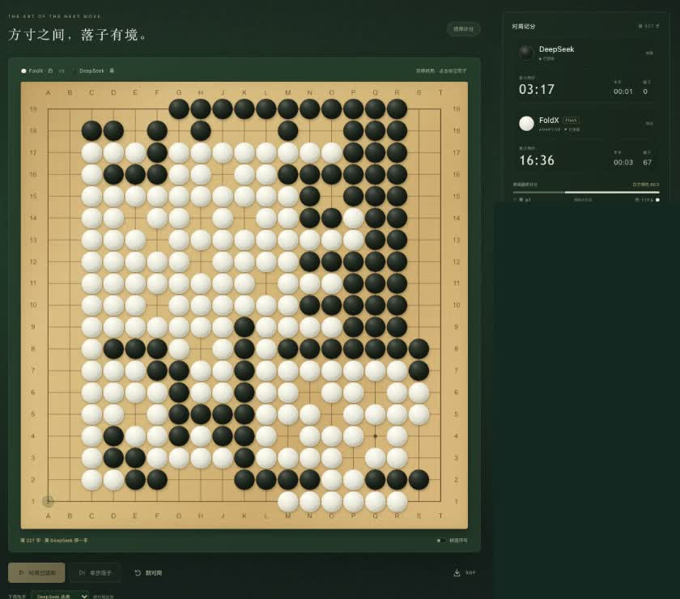
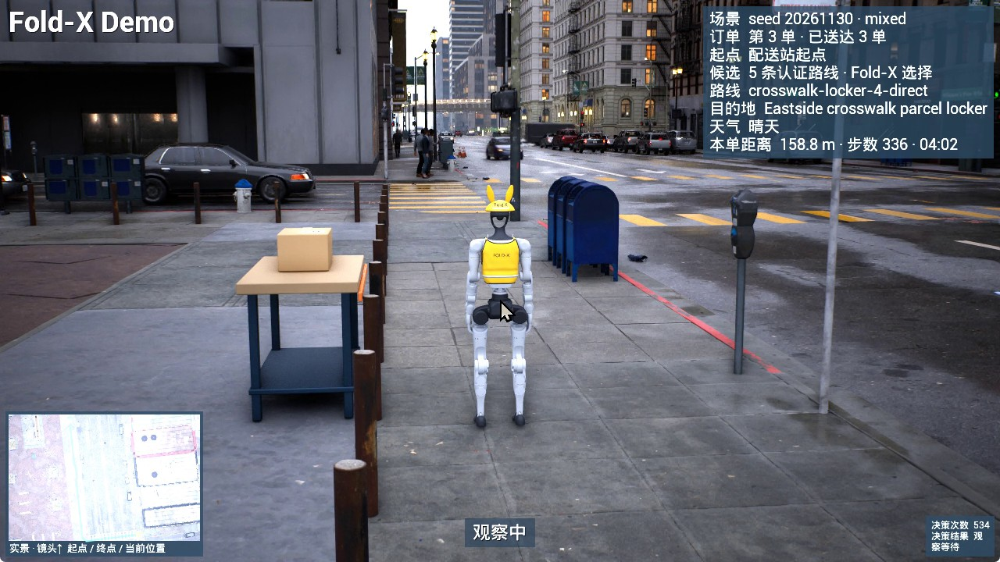
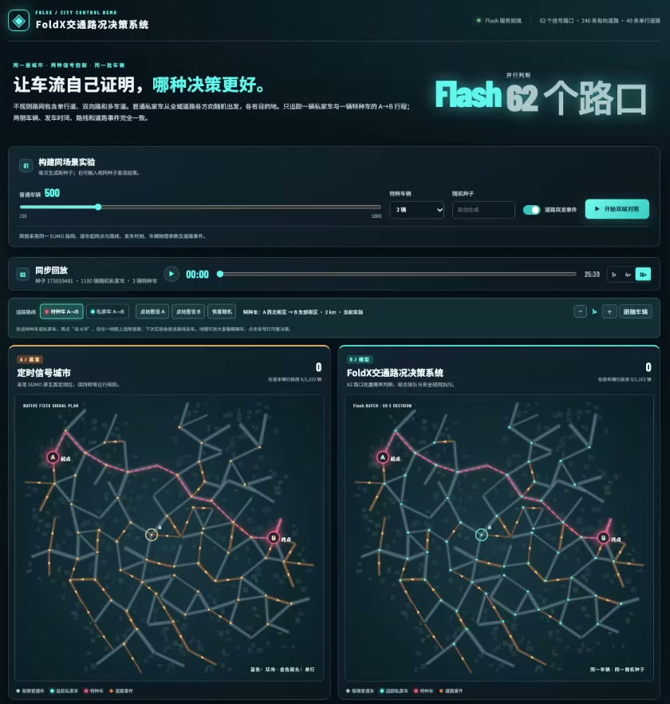
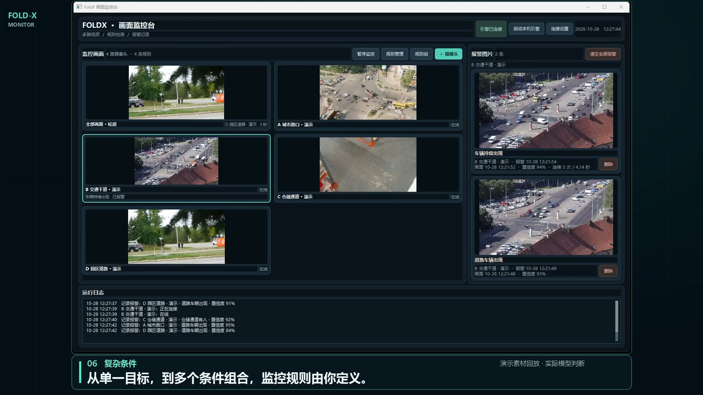
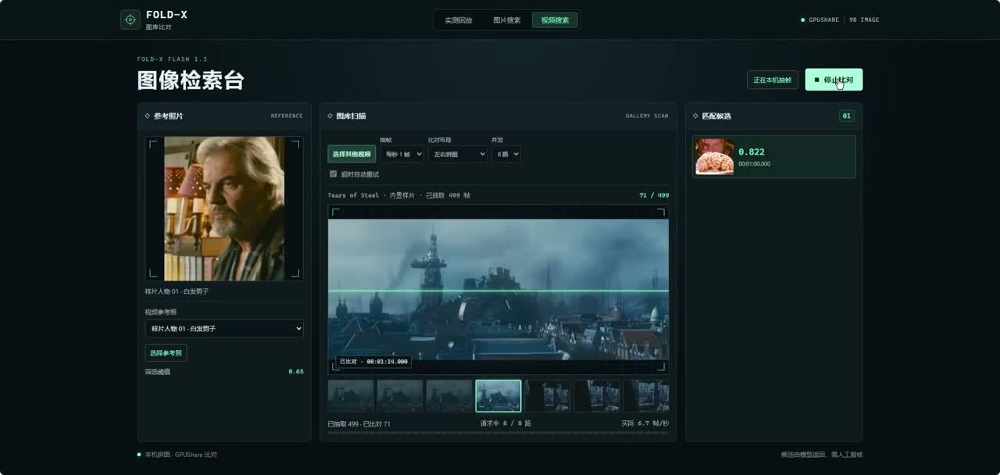
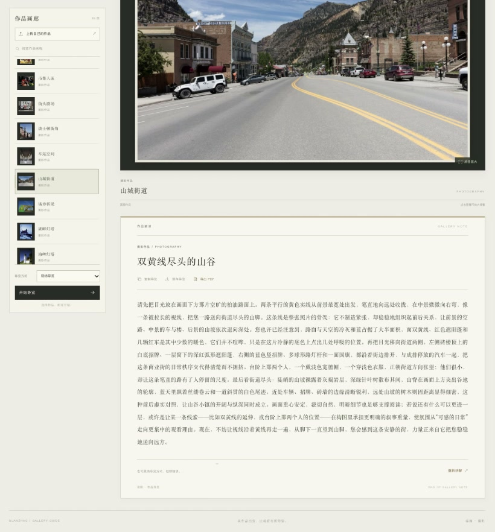
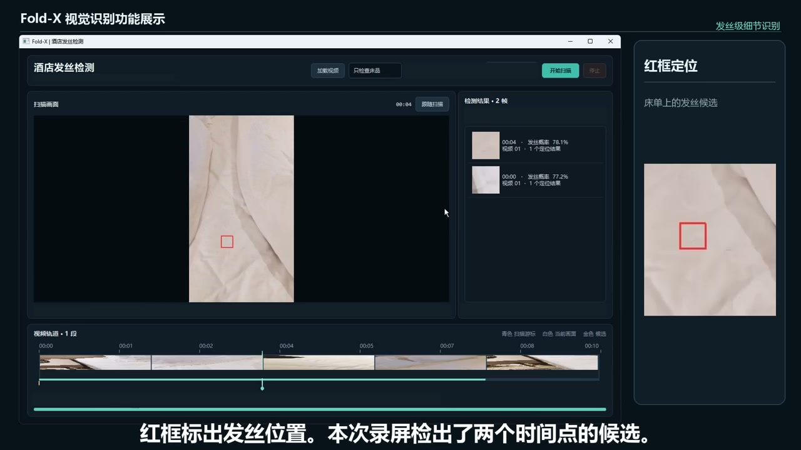
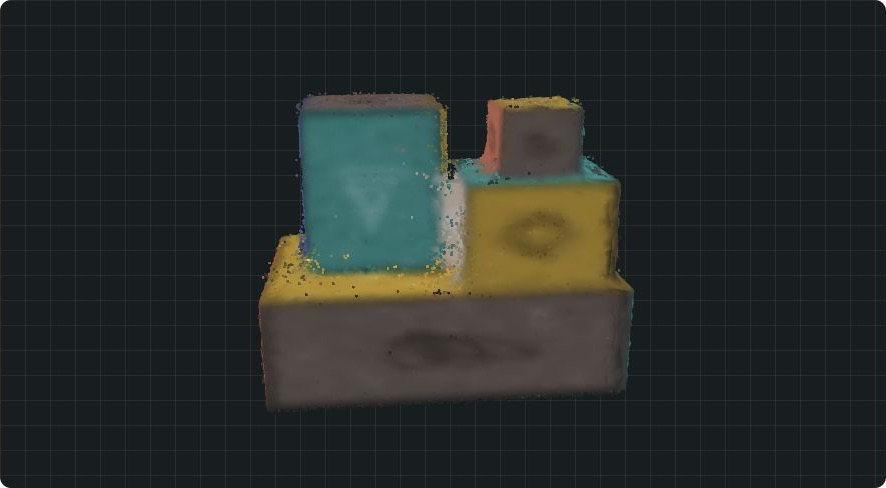

# Fold-X

[中文版](README.md) | [English](en/README.md)

**Fold-X，低成本训练的多模态实时分析模型，更准、更快、更省。**

Fold-X 将文字与图像转化为应用可用的判断、选择与评分。当前已提供 Flash-1.3 文字与图像 API。

Fold-X Max 已完成训练。

[申请 API 试用](docs/contact.md) · [接入说明](docs/api.md) · [常见问题](docs/faq.md) · [完整预览](https://skywalkerhm.github.io/Fold-X/index.html)

## 01 · 评测成绩

### ImageJevBench · 视觉定位综合表现

Fold-X Pro 80.70、Max 80.19、Flash 80.15、Light 77.54。在所提供的参照集合中，合并排序参考位置分别为第 4、5、6、8 位。

|参照榜原名次|模型|定位综合分|
|---:|---|---:|
|1|GLM-4.6V|89.47|
|2|Qwen3-VL-32B Instruct|85.27|
|3|H2O Lightning 4B v1.4.1 (H2O serving package)|84.90|
|**↳**|**Fold-X Pro**|**80.70**|
|**↳**|**Fold-X Max**|**80.19**|
|**↳**|**Fold-X Flash**|**80.15**|
|4|Claude Haiku 5.5|78.81|
|**↳**|**Fold-X Light**|**77.54**|
|5|Gemma 4 31B IT|76.44|
|6|Qwen3-VL-235B-A22B Instruct|75.99|
|7|Qwen3-VL-30B-A3B Instruct|75.86|
|8|Jev 1.14.0|75.71|
|9|Qwen3.5-397B-A17B|74.69|
|10|Qwen3-VL-8B Instruct|72.78|
|11|GPT-6 Luna|70.70|
|12|Qwen3.6-35B-A3B|63.43|
|13|H2O Lightning 4B (image, v1.1)|62.58|
|14|Imajev-4B|47.13|
|15|H2O Lightning 4B v1.4.1 (weights only)|41.13|
|16|Qwen3.5-4B (base of Imajev-4B)|38.36|
|17|Imajev-9B|37.66|
|18|Moondream 3 (preview)|35.72|
|19|Florence-2-large|28.95|
|20|Florence-2-large-ft|27.85|

来源：项目方于 2026-11-18 提供的对照表与截图。编号行保留所提供的参照榜原名次；Fold-X 已提交官方申请，等待官方收录；按分数插入展示，不表示官方收录名次。“定位综合分”不是准确率百分比，与 DecisionBench 成绩分别呈现。

[成绩来源与适用范围 →](benchmarks/imagejevbench.md)

### DecisionBench · 文本决策评测

DecisionBench 1.0 全量 **23,900 题**。以下为作者提交结果，Flash、Light 均完成全量任务，调用记录无错误或不支持题目；这不代表所有题目回答正确。

|模型|准确率|提交成绩参考位置|结果来源|
|---|---:|---:|---|
|Fold-X Flash|**76.85%**|**位于主榜第 3–4 名分数之间**|[提交 #85](https://github.com/Hanno-Labs/decision-bench-results/pull/85)|
|Fold-X Light|**74.48%**|**位于主榜第 5–6 名分数之间**|[提交 #82](https://github.com/Hanno-Labs/decision-bench-results/pull/82)|

[完整任务表现、对照结果与计算口径 →](benchmarks/decisionbench.md)

### 已收录 Top 10 · 提交成绩参考插入

|归档名次|模型 / 提交版本|准确率|记录来源|
|---:|---|---:|---|
|1|Hanno-Labs/bosun-v3.1-1.7b|84.90%|[主榜归档](https://github.com/Hanno-Labs/decision-bench-results/tree/e2d6a133cee91b9d8c6fbd076b21f32f3d75c81f)|
|2|Hanno-Labs/bosun-v3.1-0.6b|81.18%|[主榜归档](https://github.com/Hanno-Labs/decision-bench-results/tree/e2d6a133cee91b9d8c6fbd076b21f32f3d75c81f)|
|**↳ 本地测试参考**|**Fold-X Pro（推理模式）**|**80.04%**|**本地测试 · 非官方收录** · 分数参考：位于主榜第 2–3 名之间。|
|3|mohit67890/imajev（简称）|79.69%|[主榜归档](https://github.com/Hanno-Labs/decision-bench-results/tree/e2d6a133cee91b9d8c6fbd076b21f32f3d75c81f)|
|**↳ 参考插入**|**Fold-X Flash (1.3 Deep)**|**76.85%**|**[已提交，尚未收录](https://github.com/Hanno-Labs/decision-bench-results/pull/85)**|
|4|EldanRing/Winnow-12B|76.65%|[主榜归档](https://github.com/Hanno-Labs/decision-bench-results/tree/e2d6a133cee91b9d8c6fbd076b21f32f3d75c81f)|
|5|ekzhang/openjev-sglang|74.82%|[主榜归档](https://github.com/Hanno-Labs/decision-bench-results/tree/e2d6a133cee91b9d8c6fbd076b21f32f3d75c81f)|
|**↳ 参考插入**|**Fold-X Light (1.0 Deep)**|**74.48%**|**[已提交，尚未收录](https://github.com/Hanno-Labs/decision-bench-results/pull/82)**|
|6|z-ai/glm-5.3-flash|74.09%|[主榜归档](https://github.com/Hanno-Labs/decision-bench-results/tree/e2d6a133cee91b9d8c6fbd076b21f32f3d75c81f)|
|7|typesafe/jev-1.13|72.03%|[主榜归档](https://github.com/Hanno-Labs/decision-bench-results/tree/e2d6a133cee91b9d8c6fbd076b21f32f3d75c81f)|
|8|deepseek/deepseek-v4.1-flash|71.00%|[主榜归档](https://github.com/Hanno-Labs/decision-bench-results/tree/e2d6a133cee91b9d8c6fbd076b21f32f3d75c81f)|
|9|openai/gpt-5.6-luna|69.90%|[主榜归档](https://github.com/Hanno-Labs/decision-bench-results/tree/e2d6a133cee91b9d8c6fbd076b21f32f3d75c81f)|
|10|razorback16/openjev|68.43%|[主榜归档](https://github.com/Hanno-Labs/decision-bench-results/tree/e2d6a133cee91b9d8c6fbd076b21f32f3d75c81f)|

编号行保留 2026-11-14 主仓库快照中 59 条当前记录的前 10 名。Flash、Light 仅按分数区间插入展示：已提交，尚未收录，不计入榜单名次，也不改变已收录模型的编号。这里展示历史快照，不是实时榜单。

## 02 · 能做什么，如何接入

Fold-X 将任务信息、目标和约束转化为明确判断，供业务系统执行与复核。应用可以提供文字、图像或整理后的状态，并将执行后的新状态用于下一次判断。具体输入形式与支持范围以服务接口为准。

|应用方向|可以承担的判断环节|
|---|---|
|文字与业务材料|分类、条件判断、证据核验、评分与多项检查；关注中文语境、指代和专业表达|
|图片与视频|按语言条件或参考图片筛选候选，定位视频片段，辅助观察细节|
|连续行动与协同|在游戏、仿真和工作流中选择下一步，结合变化的状态协调多个节点|

通过 API 接入：**提供任务与可选项 → 获得判断 → 应用执行并反馈新状态**。当前可调用 Flash-1.3 文字与图像接口；Light、Pro 的接入安排请联系团队确认，评测版本不自动等于在线服务版本；复杂应用需配套场景适配与验证。业务系统负责执行权限、异常回退和人工复核。

## 外部测评结果

**外部评测方报告：Fold-X Pro 在16项公开基准、共1,574题的抽样评测中，总体准确率为82.72%。** 标准模式在RTE文本蕴含判断、QQP问题语义匹配、TweetEval情感分类三项中，位列报告三模型参照的第一或并列第一。另一个231题公开决策集上，自适应模式准确率为85.28%。

此组为外部测评结果，与团队自测分开呈现。参照位置据报告和归档对照值整理，不是官方榜单名次；评测日期为2026年11月3日，材料未证明另两个模型同步重跑。

[查看16项完整成绩、模式、响应时间与口径](benchmarks/external-evaluation.md)

## 任务中的准、快、省

| 关注点 | 选列结果 | 适用范围 |
|---|---|---|
| 准确性 | 936题分类：89.32%，对照79.59% | 历史团队测试，与同等规模模型对比 |
| 中文理解 | C-SEM四项1,200题：93.33% | Flash深度配置，公开集自测 |
| 速度 | 1,213题累计推理耗时减少75.5% | 本地模型计时，不是完整API延迟 |
| 费用 | 一组批量任务估算API费用降低10.5% | 历史完整工作流，不是模型单次调用收益 |

匿名企业试用也记录了更少的弃权与判错。该样本类别高度不均衡，准确率结论受限；详情同时列出多数类基线与计时边界。

[查看结果、匿名企业反馈与完整口径](benchmarks/product-results.md)

### 中英文长材料理解与事实核验

| 任务 | 历史报告结果 | 配置 |
|---|---|---|
| 中文段落检索 · LongBench v1 | **100.0%（200/200）** | Flash · 深度 |
| 英文段落检索 · LongBench v1 | **98.5%** | Flash · 深度 |
| 英文幻觉检测 · RAGTruth | **F1 66.71%，2,700条** | Light · 标准 |

来源为2026年10月20日团队评测汇总。成绩仅对应指定任务与配置，不是整个基准的总分，也不等于当前API服务表现；F1不是准确率。本组结果不作官方排名或外部认证宣传。

[查看完整结果、中文业务分项及适用边界](benchmarks/product-results.md)

## 支撑能力探索的公开研究

三篇公开预印本，记录团队在推理质量、效率评估与数学任务表现方面的研究积累。它们提供研究依据与探索背景，不作为当前 Fold-X API 或十个演示的直接性能认证。

- **[Virtual MoE：推理质量与可靠性](https://arxiv.org/abs/2504.03739)**：研究小模型场景中的推理质量与幻觉缓解；结论限于论文所测模型和任务。
- **[SemanticFold：同时考察效率与能力](https://arxiv.org/abs/2610.10304)**：考察压缩条件下不同能力指标是否得到保留。不同指标可能朝不同方向变化，单项改善不能代表所有能力同时提升。
- **[任务呈现与执行路径如何影响大模型数学表现](https://arxiv.org/abs/2611.11102)**：通过配对实验，研究任务呈现和可用信息对数学作答的影响，说明不同条件对结果的贡献与适用边界。

以上为 arXiv 预印本，不表示已通过同行评审或取得独立产品认证；实验条件与限制以各论文为准。此处不展开未公开的内部实现。

## 03 · 十项能力，逐步展开

**决策能力展开：策略判断 → 快速行动 → 复杂环境 → 多点协同。**

**视觉理解深入：语言理解画面 → 参考图识别 → 审美与细节分析 → 精细视觉质检。**

两段展示相互衔接：前四个案例关注如何行动，后四个进一步展示如何理解画面与判断依据。这是展示叙事的递进，不是同一测试下的能力等级认证。

速度贯穿其中：判断需要及时返回，才能支持交互与连续处理。播放倍速、界面吞吐、单次模型延迟及云端 API 耗时分开说明，不能相互替代。

以下演示用于直观看到应用过程。单次运行、仿真与局部读数不构成通用准确率、性能或部署承诺；具体证据范围见各案例。

### 01 · 智能与策略判断｜围棋对弈

Fold-X Flash 执白，与 DeepSeek 执黑进行 19×19 围棋对弈。通过连续落子，展示对局面、候选选择与后续影响的判断。

[观看视频与关键截图](cases/01-go.md) · [打开播放器](https://skywalkerhm.github.io/Fold-X/cases/01-go.html)

### 02 · 快速准确决策｜超级玛丽

面对移动的敌人、变化的地形与有限的行动时机，Fold-X 根据当前游戏状态持续选择前进、跳跃或等待。左侧看行动效果，右侧看当时的状态、所选动作与候选分数。

[观看视频与关键截图](cases/02-mario.md) · [打开播放器](https://skywalkerhm.github.io/Fold-X/cases/02-mario.html)

### 03 · 复杂环境决策｜机器人快递员

在 UE 城市仿真中，Fold-X 根据天气、行人、车辆、信号和任务进展持续作出判断，完成三单配送及返站。场景中的随机变化及其对能见度、通行条件和交互的影响，均纳入连续决策。

**5 倍速播放 · 约 4 分钟 · UE 仿真**

[观看视频与关键截图](cases/03-robot.md) · [打开播放器](https://skywalkerhm.github.io/Fold-X/cases/03-robot.html)

**跟随目标，持续判断，完成投递**

在 UE 城市仿真中，Fold-X 支持机器人识别并跟随指定领路对象，在目标暂时被遮挡时保持任务连续性，并根据现场情况选择继续、减速或等待观察，直至完成投递。

[观看完整场景与结果 →](https://skywalkerhm.github.io/Fold-X/cases/03-robot.html#follow-delivery)

### 04 · 多点协同决策｜交通信号调度

Fold-X 根据仿真中不断更新的车流，参与 62 个路口的信号决策。一个路口的放行会影响后续路段，局部选择需要放到整个路网中观察。

[观看视频与关键截图](cases/04-traffic.md) · [打开播放器](https://skywalkerhm.github.io/Fold-X/cases/04-traffic.html)

### 05 · 自然语言理解画面｜画面监控与视频搜索

用自然语言描述目标、行为或组合条件，Fold-X 判断画面是否匹配。监控应用记录命中画面；视频搜索返回候选缩略图与时间位置，便于跳转回看。

[观看视频与关键截图](cases/05-visual.md) · [打开播放器](https://skywalkerhm.github.io/Fold-X/cases/05-visual.html)

### 06 · 以图理解与识别｜参考图片检索

用一张参考图片表达要找的内容，再在图片集合与视频画面中比较、识别和判断。应用展示候选、分数与对应的视频时间位置。

[观看视频与关键截图](cases/06-image-search.md) · [打开播放器](https://skywalkerhm.github.io/Fold-X/cases/06-image-search.html)

### 07 · 审美理解与细节鉴察｜艺术鉴赏与古董观察

从绘画与摄影中的线条、色彩、构图和空间关系出发，尝试解释画面氛围；把细致观察延伸到器物图片，整理可见线索与需要继续核验的问题。

[观看视频与关键截图](cases/07-art.md) · [打开播放器](https://skywalkerhm.github.io/Fold-X/cases/07-art.html)

### 08 · 精细视觉质检 — 床品质检：发丝检测

面向床品清洁质检，在纹理、褶皱与低对比度画面中发现疑似发丝，标出位置并放大复核。重点展示发现疑似问题、定位证据、辅助人工复核的视觉质检能力。

把需要人工逐帧寻找的细节整理为候选位置，辅助复核与留档，为布草检查、纺织品异物筛查等场景提供试点方向。

[视频、关键截图与应用范围](cases/08-fine-detail.md) · [打开播放器](https://skywalkerhm.github.io/Fold-X/cases/08-fine-detail.html)

### 09 · 视频生成与跨镜头一致性

通过一段 50 秒科幻样片，展示一键视频生成的应用探索，重点观察跨镜头的人物外观、环境、光照与色彩衔接。

[ 一键视频生成 ·《静默载荷》 ](cases/09-video-generation.md) · [Video](https://skywalkerhm.github.io/Fold-X/cases/09-video-generation.html)

### 10 · 深度估算与三维重建

从一张厨房照片中看出前后景的远近，或用一段绕积木拍摄的视频，生成可旋转查看的三维模型。

[案例详情](cases/10-depth-workbench.md) · [打开深度工作台，试用内置示例](https://121.41.214.107:8880/)

## 补充附件：VisNumBench 视觉数值判断

将视觉信息转化为数量与空间尺度判断：从图片中判断数量、大小、远近和几何关系，并选出正确的数值答案。附件包含 1,913 道选择题的四档成绩；准确率指答题正确率，名次为各档分别与公开参照模型比较的本地参考排名。

[查看补充附件](appendices/visnumbench.html)

## 试用与联系

申请 API 试用或讨论业务场景，请联系 [刘先生 — msfocus@gmail.com](mailto:msfocus@gmail.com) 或 [黄先生 — huangminl4@hotmail.com](mailto:huangminl4@hotmail.com)。

[完整联系方式与电话](docs/contact.md) · [API能力与接入](docs/api.md) · [精简FAQ](docs/faq.md)

普通产品问题可在本仓库启用后的 **Issues** 标签页留言。密钥、客户资料与非公开商务信息请通过邮件沟通。

---

本仓库发布产品说明、评测引用与展示素材，核心实现和模型权重不在此发布。视频中的第三方素材署名见对应案例。
