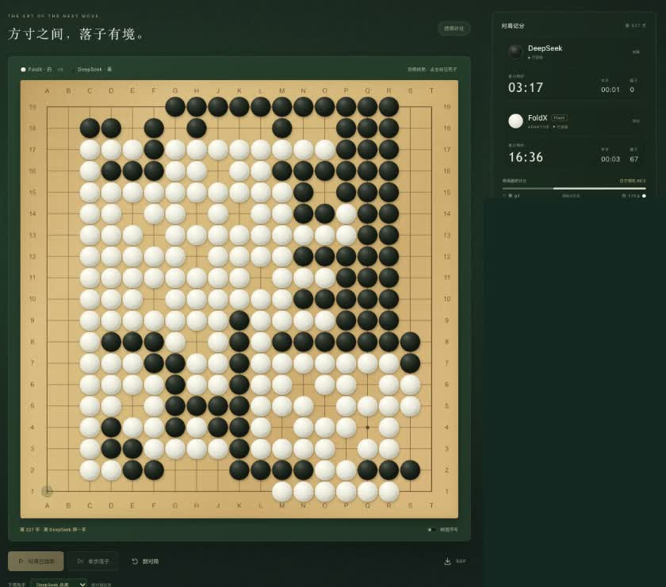
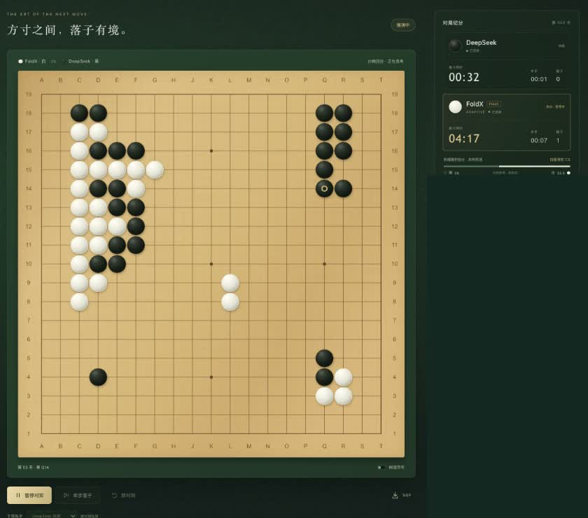
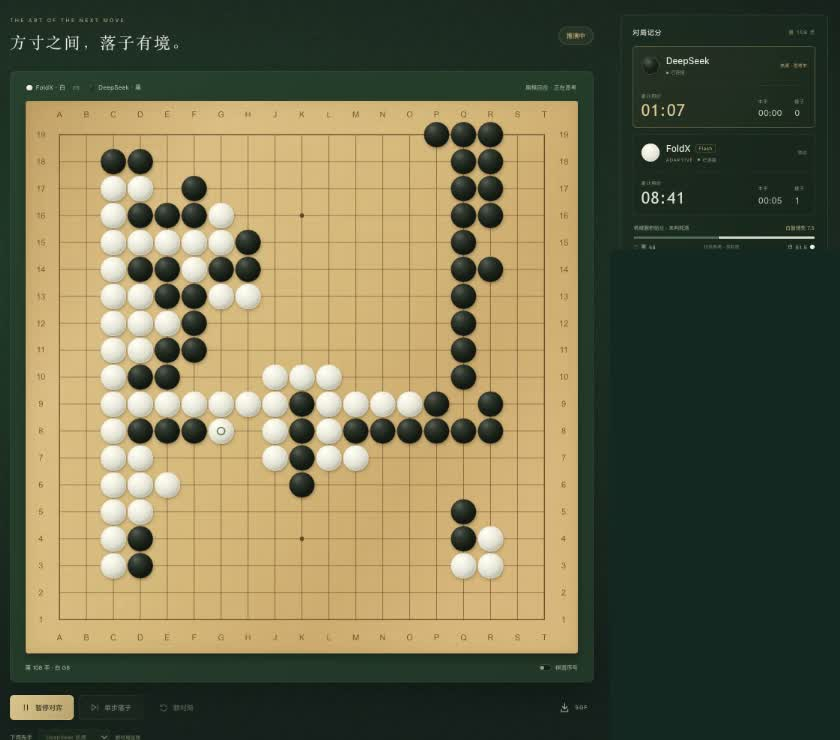

# 案例 01 · 围棋对弈

[English](../en/cases/01-go.md)

**智能与策略判断 · 理解局面，权衡下一步**

Fold-X Flash 执白，与 DeepSeek 执黑进行 19×19 围棋对弈。通过连续落子，展示对局面、候选选择与后续影响的判断。

## 能力递进

起点是策略判断：在明确规则下理解当前局面，并选择行动。

## 演示视频

[观看视频 · 围棋对弈 · 5 倍速 · 约 4 分 4 秒](../assets/cases/go/fold-x-go-5x.mp4)

## 应用价值

适用于需要比较候选方案、权衡局部得失与后续影响的决策任务。

## 观察结果与证据边界

- 结束界面的估分显示白方领先 80.5；对手具体版本未提供。
- 视频保留原始对弈顺序，聚焦棋盘与计分。

这是单局演示的界面估分，未经独立裁判核验，不等于多局胜率或综合智力评测。

**速度口径：** 5 倍速用于缩短观看时间，不代表模型响应速度。

## 关键画面

### 开局与落子

### 中盘局面变化

[打开案例播放器](https://skywalkerhm.github.io/Fold-X/cases/01-go.html) · [浏览全部案例](https://skywalkerhm.github.io/Fold-X/index.html#cases) · [返回 GitHub 首页](../README.md)
