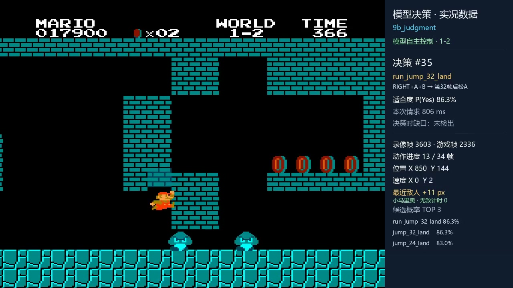
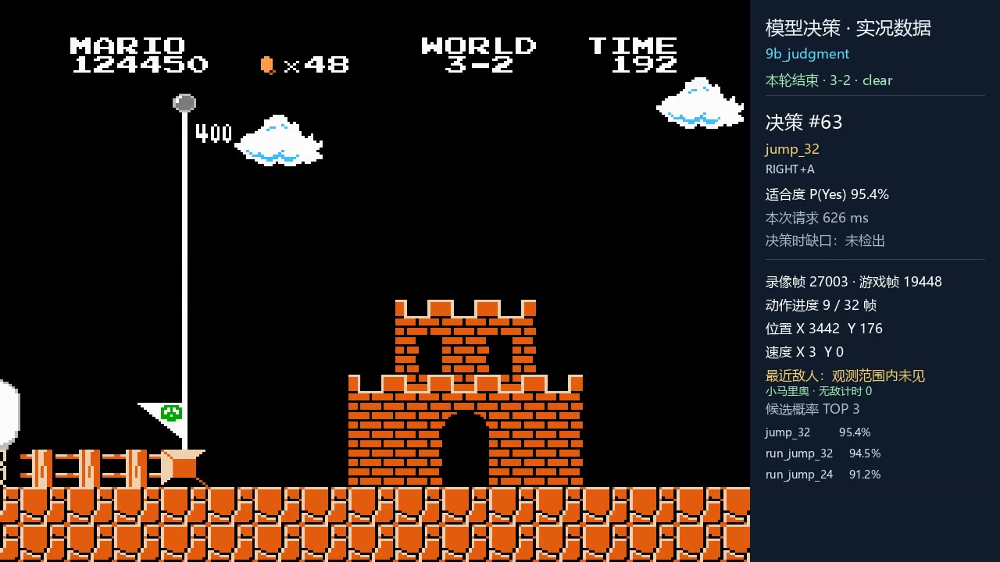

# 案例 02 · 超级玛丽

[English](../en/cases/02-mario.md)

**快速准确的行动决策 · 在变化中及时行动**

面对移动的敌人、变化的地形与有限的行动时机，Fold-X 根据当前游戏状态持续选择前进、跳跃或等待。左侧看行动效果，右侧看当时的状态、所选动作与候选分数。

## 能力递进

从策略选择进一步走向时机把握：环境持续变化，判断需要及时转化为有效动作。

## 演示视频

[观看视频 · 超级玛丽 · 5 倍速 · 约 4 分 19 秒](../assets/cases/mario/fold-x-mario-5x.mp4)

## 应用价值

适用于游戏智能体、交互应用与需要连续反馈的行动选择。

## 观察结果与证据边界

- 录屏包含多个关卡的连续行动，结束于 4-3 关卡。
- 右侧面板是状态与决策摘要；候选分数不是实测准确率或通关概率。

演示用于观察行动时机与效果，未统计多次运行成功率，不表示全游戏通关，也不据此声称仅靠原始像素控制。

**速度口径：** 全段 5 倍速；真实请求耗时应按运行记录统计，不能从播放速度推算。

## 关键画面

### 当前状态与动作对应

### 3-2 关卡旗杆场景

### 结束前仍在 4-3 关卡行动

展示版保留游戏、当前状态与动作选择，遮去面板底部的技术说明。

[打开案例播放器](02-mario.html) · [浏览全部案例](../index.html#cases) · [返回 GitHub 首页](../README.md)
