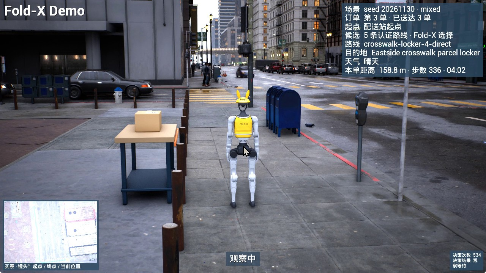
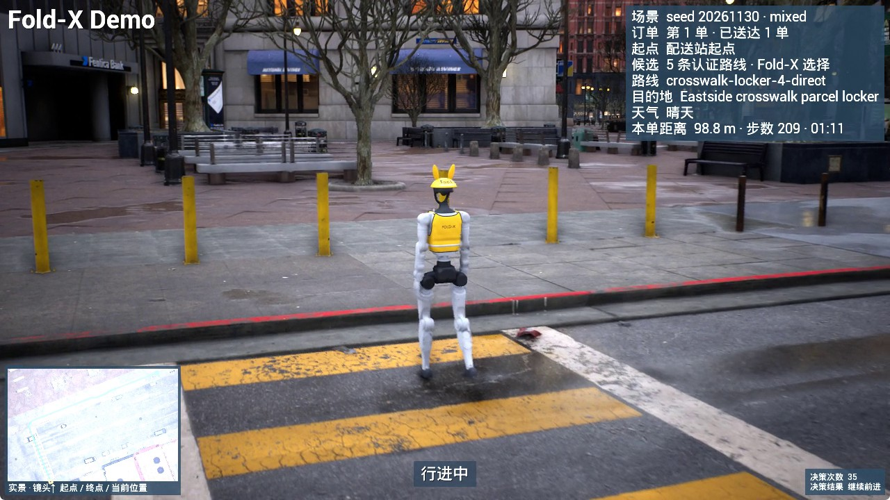
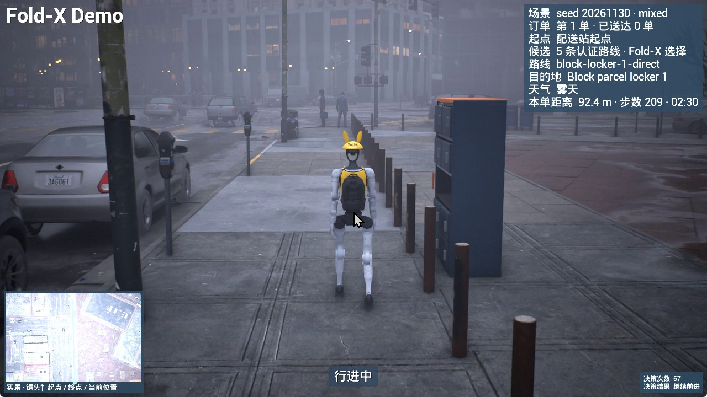
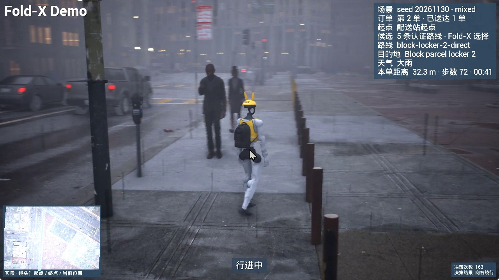
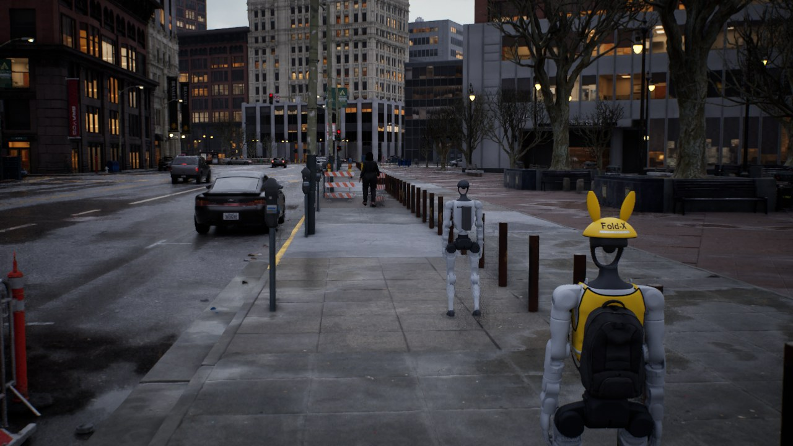
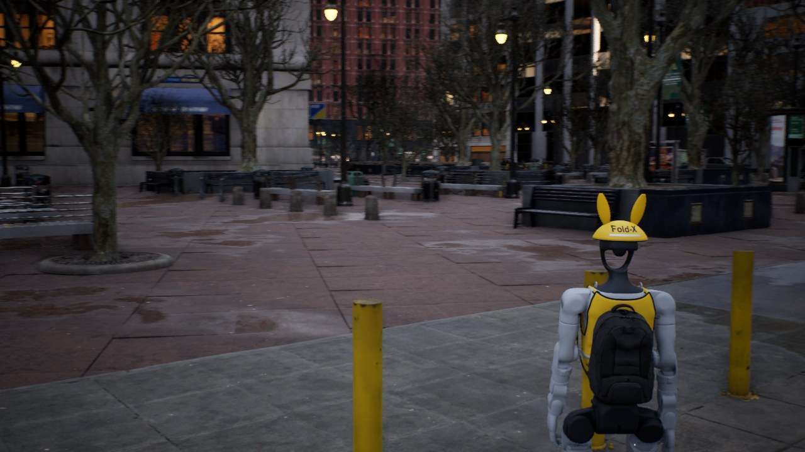
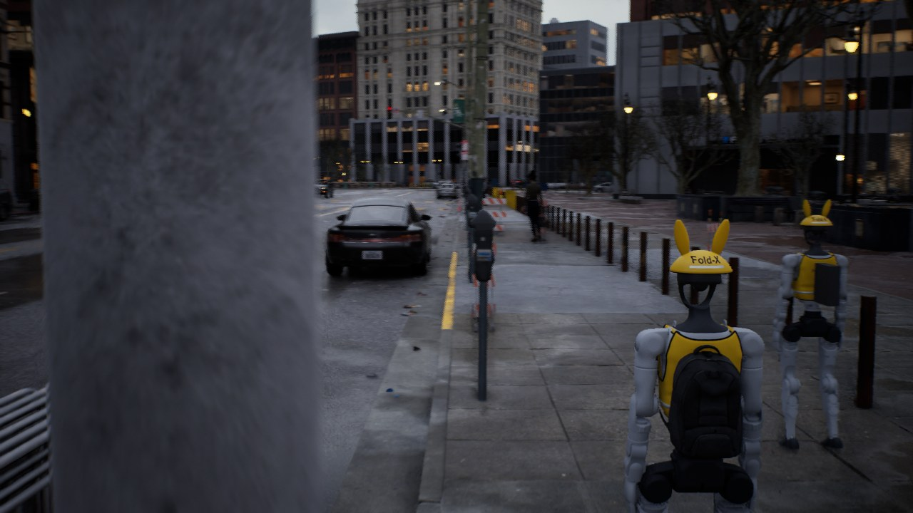
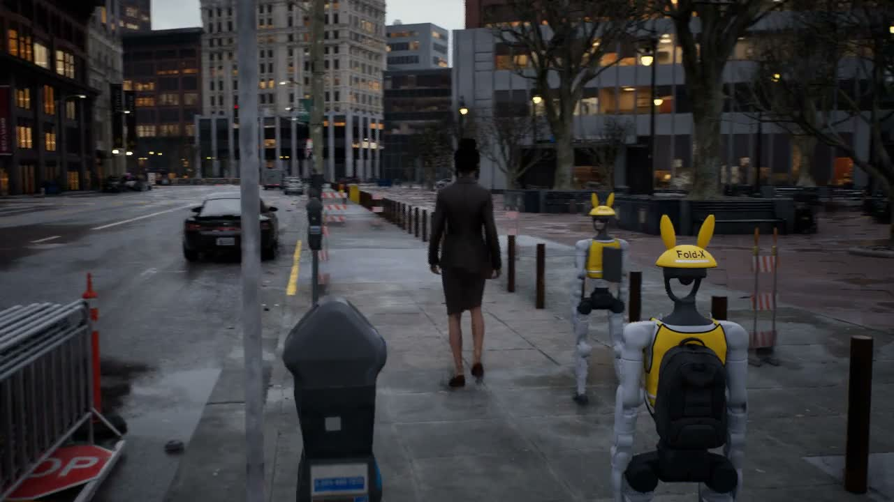

# 案例 03 · 机器人配送

[English](../en/cases/03-robot.md)

**复杂环境决策**

在 UE 城市仿真中，Fold-X 根据天气、行人、车辆、信号和任务进展持续作出判断，完成三单配送及返站。场景中的随机变化及其对能见度、通行条件和交互的影响，均纳入连续决策。

## 能力递进

从及时选择一个动作，推进到在变化环境中持续完成任务：出发、途中判断、送达、返站，再开始下一单。

## 场景中的决策能力

- 随机变化参与决策：天气变化及动态人车状态会更新现场信息，供 Fold-X 判断前进、等待或调整行动；行动执行仍受安全约束。
- 完整任务执行：记录覆盖三单送达和三次返站，并包含去程与返程过街。
- 边行动边交互：根据现场状态决定是否回应行人及回应时机。对话文本由外部语言模型生成。

## 演示视频

完整三单配送与返站 · 5 倍速 · 约 4 分钟

路缘处理专项 · 5 倍速 · 约 29 秒

## 应用价值

探索园区配送、巡检和服务机器人中的连续任务决策：在环境变化与交互打断下，持续围绕目标调整行动。

## 观察结果与证据边界

- 完整三单记录：三次送达、三次返站；日志未记录行人或车辆接触，记录一次静态路缘接触。
- 路缘处理专项：单独完成一次送达及返站，记录一次主动跨阶，未记录接触事件；该结果仅限这次独立专项运行。
- 随机场景机制及现场信息进入决策流程已核对；本次运行未记录随机起点触发，也尚无多随机种子的汇总成绩。

本例为一次 UE 仿真运行，不代表实体机器人部署或多次随机试验的成功率。路线选择在预设候选范围内进行，不能描述为无约束自主探索。

两段视频均为 5 倍速；完整录像约 20 分钟，展示约 4 分钟；专项录像约 2 分 24 秒，展示约 29 秒。播放时长不代表真实任务耗时或单次决策延迟。

## 关键画面

### 送达交付点

### 动态对话与现场状态

### 三单完成并返回配送站

### 路缘处理专项复核

## 跟随目标，持续判断，完成投递

在 UE 城市仿真中，Fold-X 支持机器人识别并跟随指定领路对象，在目标暂时被遮挡时保持任务连续性，并根据现场情况选择继续、减速或等待观察，直至完成投递。

从独立配送延伸到领路与跟随配合，探索园区运输、引导服务及协作配送中的任务执行。

通用人物跟随 · 原速

信号过街跟随 · 原速

复杂地图 · 1.3 倍人群 · 原速

复杂地图 · 1.5 倍人群压力 · 原速

以下为四次指定场景的记录，已核对来源摘要，未在本次重新运行实验。三组正式场景均记录投递完成与零接触，但通用人物场景的间距检查未通过；压力场景单独呈现，不据此宣称全场景成功率或全程安全。

|场景|投递完成|接触次数|观测间距（米）|间距检查|
|---|---|---:|---|---|
|通用人物跟随|是|0|2.253–9.492|未通过|
|信号过街跟随|是|0|2.137–4.316|通过|
|复杂地图 · 1.3 倍人群|是|0|2.329–3.199|通过|
|复杂地图 · 1.5 倍人群压力|是|1|2.054–7.362|未通过|

过街场景清理了路缘局部人群，因此不能将过街与密集人群结果合并为“密集人群过街已验证”。压力场景仅附视频与摘要。系统保留执行安全约束，结果为整体仿真表现，不等于实体机器人部署验证。

本组短片保留原始播放速度，分别约 33 秒、72 秒、23 秒和 36 秒。录像取帧约 4 FPS，不代表模型推理或控制频率。

[↩ 全部能力](../index.html#cases)
