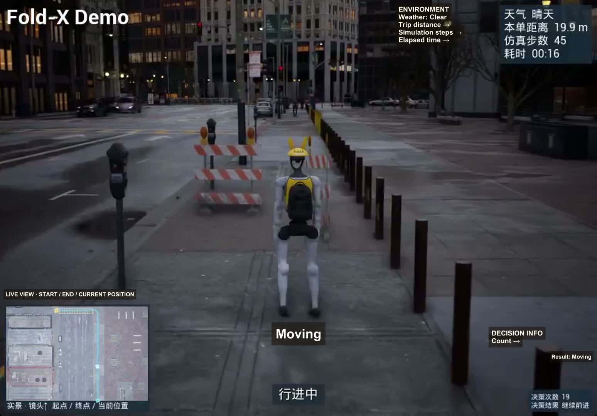
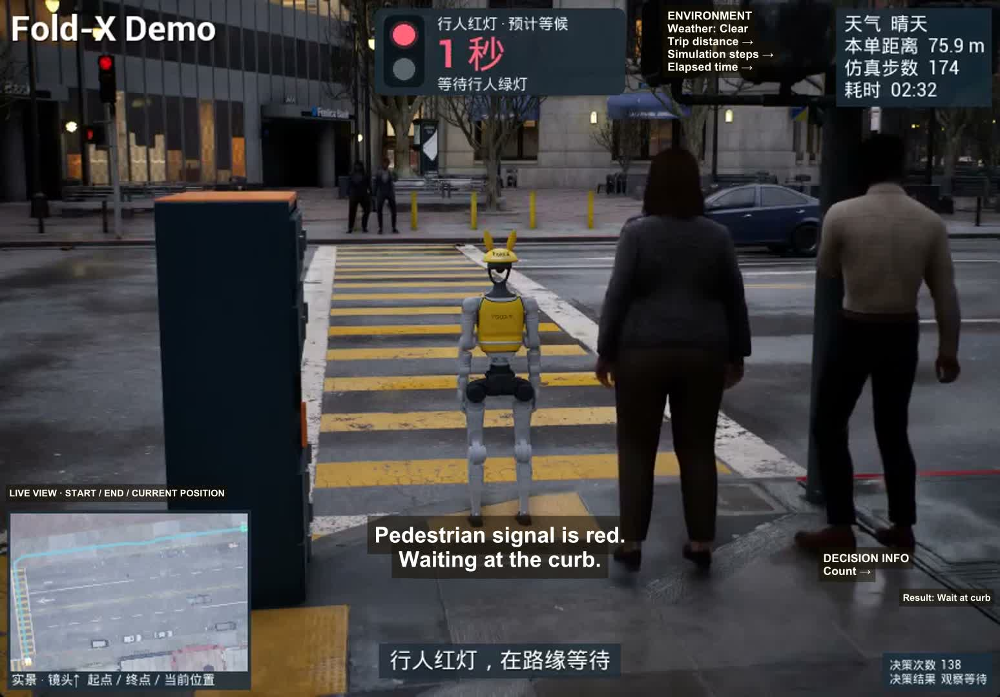

# 案例 03 · 机器人快递员

[English](../en/cases/03-robot.md)

**复杂环境中的连续决策 · 结合多种因素调整行动**

在 Unreal Engine（UE）派送仿真中，为机器人设定目标，环境要素、行人与车辆随机投放。Fold-X 根据当下的外界信息，持续决定前进、等待或调整行动。

## 能力递进

从游戏中的行动时机，推进到多因素判断：目标、行人、车辆、信号与通行条件需要一起考虑。

## 演示视频

[观看视频 · 机器人快递员 · 原速 · 约 4 分 7 秒](../assets/cases/robot/fold-x-robot-delivery.mp4)

## 应用价值

探索机器人与世界交互的一种方式：围绕目标观察变化，作出反馈，并随新状态继续调整。

## 观察结果与证据边界

- 按项目资料，使用宇树 G9 虚拟机器人模型；该名称为项目资料标识。
- 演示包含绿灯剩余时间不足时等待、红灯时停在路缘，以及随后继续行进。
- 项目方说明未针对该派送场景与路线进行专项预训练；这不意味着基础模型从未训练。

当前是 UE 仿真，未证明在实体机器人上部署、完成整段派送或达到真人行为水平。

**速度口径：** 保留原始播放速度；录像时长不是单次决策延迟。

## 关键画面

### 虚拟街区与任务环境

### 观察行人与信号

### 条件变化后继续行进

[打开案例播放器](03-robot.html) · [浏览全部案例](../index.html#cases) · [返回 GitHub 首页](../README.md)
