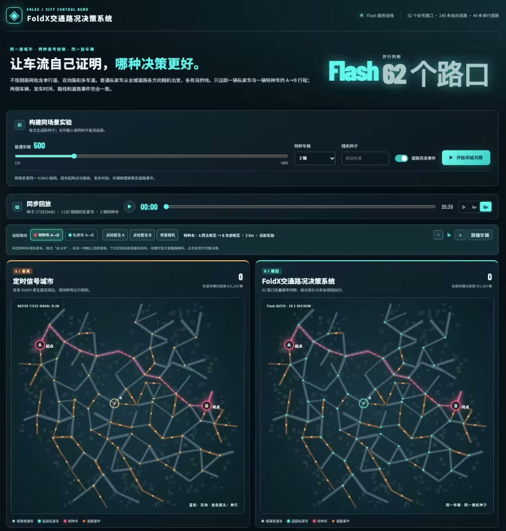
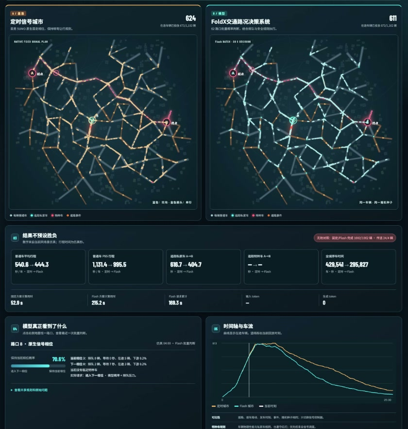
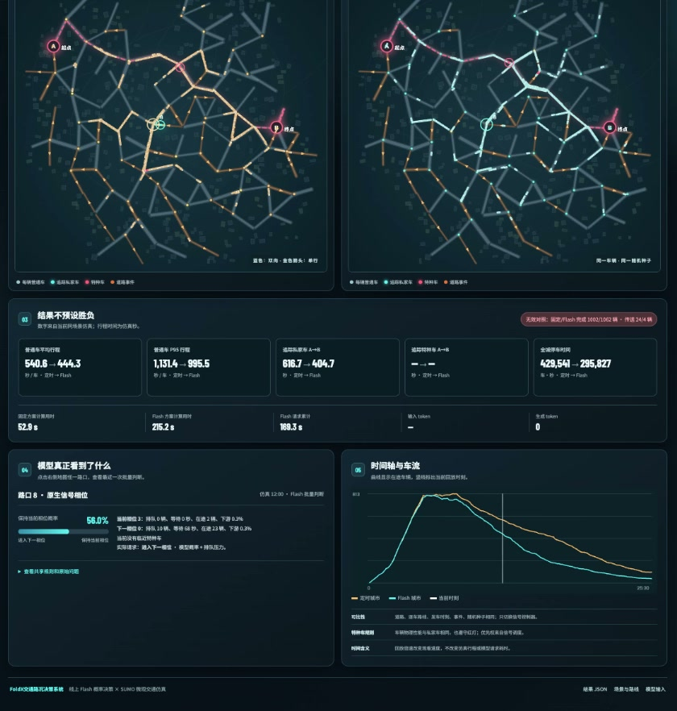
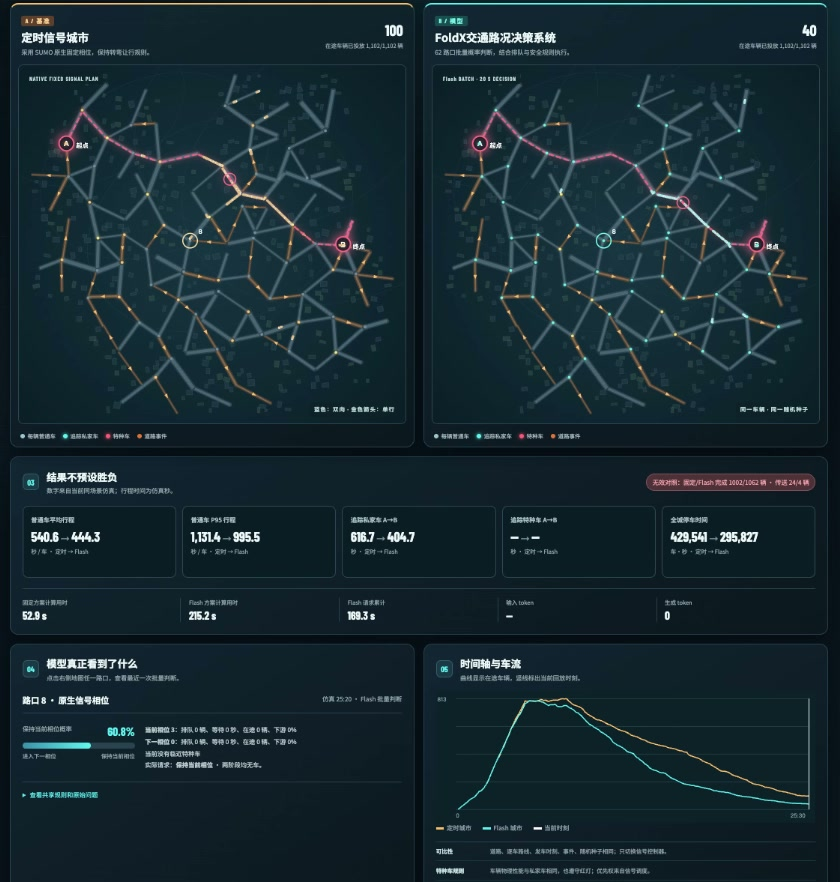

# 案例 04 · 交通信号调度

[English](../en/cases/04-traffic.md)

**多个决策点的协同 · 持续协调 62 个路口**

Fold-X 根据仿真中不断更新的车流，参与 62 个路口的信号决策。一个路口的放行会影响后续路段，局部选择需要放到整个路网中观察。

## 能力递进

从一个行动主体推进到多个相互影响的节点：各路口既有局部需求，也共同影响路网运行。

## 演示视频

[观看视频 · 62 个路口协同 · 约 1 分 50 秒](../assets/cases/traffic/fold-x-traffic-62.mp4)

## 应用价值

适用于多节点调度、资源分配与持续协调场景的功能探索。

## 观察结果与证据边界

- 展示 62 个路口随仿真路况变化持续作出选择。
- 界面将本轮标记为“无效对照”，不据此报告交通效率提升。

这是动态仿真与回放，不代表真实城市部署、全局最优，也不证明单次 API 调用完成全部 62 个路口的判断。

**速度口径：** 录屏未额外加速；原应用回放显示 16 倍速，不能据此推算实际决策吞吐。

## 关键画面

### 路口之间的车流联系

### 局部选择与后续变化

### 结束状态及对照标记

[打开案例播放器](04-traffic.html) · [浏览全部案例](../index.html#cases) · [返回 GitHub 首页](../README.md)
