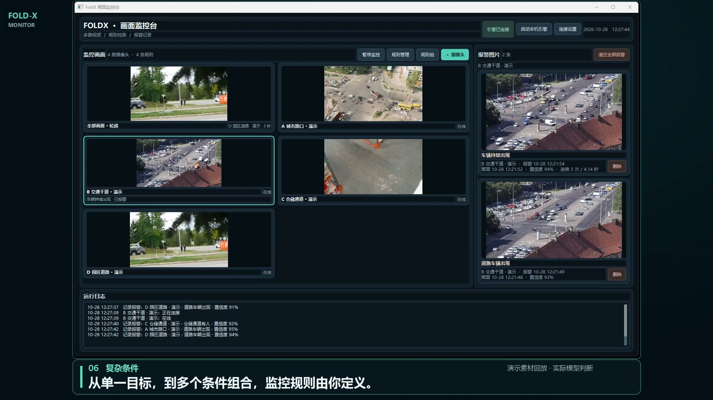
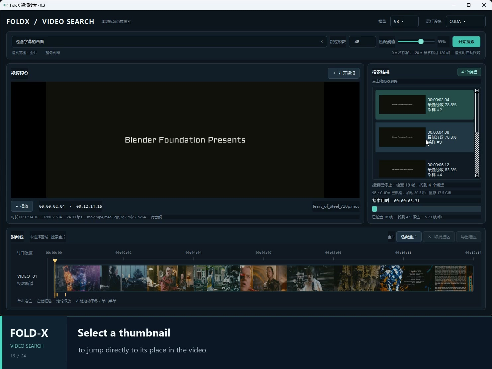
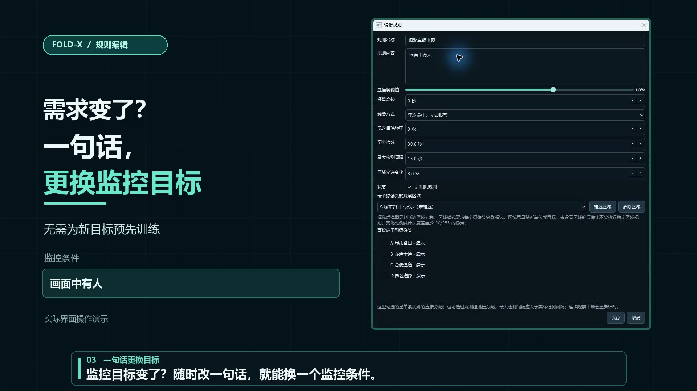
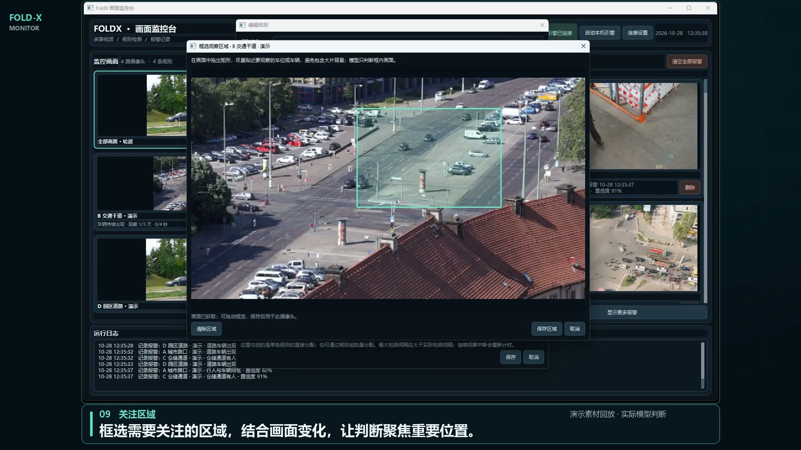
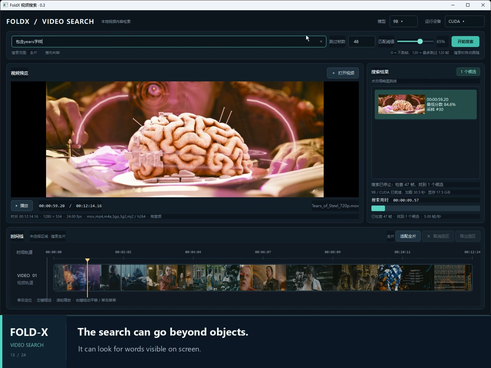

# 案例 05 · 画面监控与视频搜索

[English](../en/cases/05-visual.md)

**自然语言理解画面 · 说出条件，找到画面**

用自然语言描述目标、行为或组合条件，Fold-X 判断画面是否匹配。监控应用记录命中画面；视频搜索返回候选缩略图与时间位置，便于跳转回看。

## 能力递进

进入视觉理解：把用户用语言表达的目标，与画面中的具体内容对应起来。

## 演示视频

[观看视频 · 画面监控 · 约 1 分 26 秒](../assets/cases/visual/monitor-promo-public.mp4)

[观看视频 · 视频搜索 · 约 3 分 37 秒](../assets/cases/visual/search-english-public.mp4)

## 应用价值

适用于监控事件筛选、视频内容检索与自然语言条件抓拍。

## 观察结果与证据边界

- 演示包含多条件判断、关注区域、命中记录和视频时间跳转。
- 监控画面使用素材回放；候选匹配分数不等于标注数据上的准确率。

附件展示功能流程，未提供完整准确率评测或可复算的单次延迟分布。

**速度口径：** 项目资料称画面判断环节可达毫秒级；本次未独立核验，不等于毫秒内搜索完整视频或云端 API 延迟承诺。

## 关键画面

### 用自然语言设定条件

### 指定关注区域

### 查看候选画面

两段展示视频保留原有顺序与音频，已剪去技术说明片段。

## 素材署名

- 音乐：Kevin MacLeod — “Universal”，[incompetech.com](https://incompetech.com/)，[CC BY 4.0](https://creativecommons.org/licenses/by/4.0/)。原片音乐有长度与音量编辑，本次随展示片段剪辑。
- 示例影片：Blender Foundation — “Tears of Steel”，[mango.blender.org](https://mango.blender.org/)，[CC BY 3.0](https://creativecommons.org/licenses/by/3.0/)。视频与截图包含影片节选。
- 监控演示：原片标注使用 Pexels 素材回放。

[打开案例播放器](05-visual.html) · [浏览全部案例](../index.html#cases) · [返回 GitHub 首页](../README.md)
