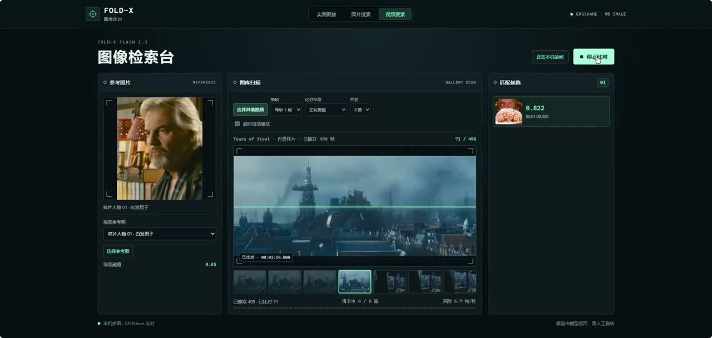
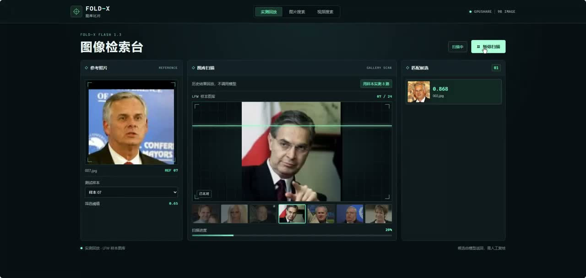
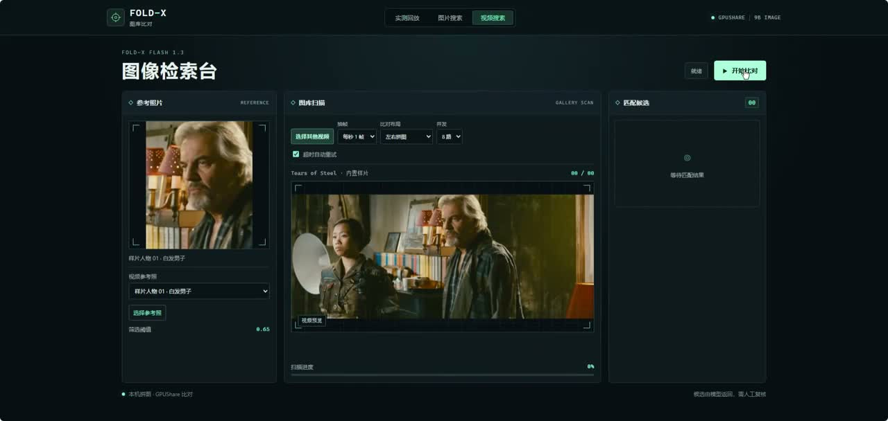
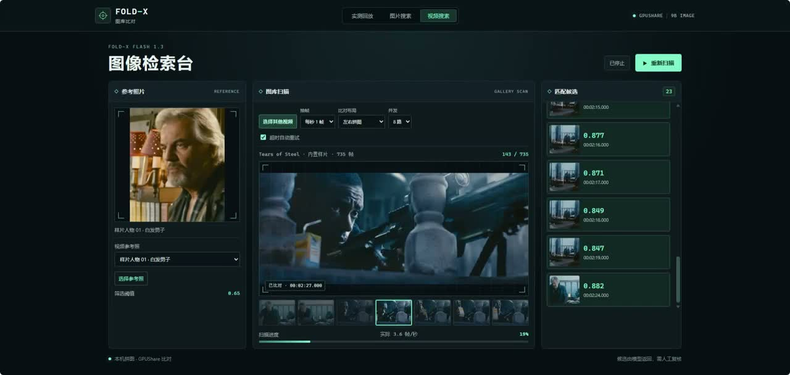

# 案例 06 · 参考图片检索

[English](../en/cases/06-image-search.md)

**以图理解、识别与判断 · 从参考图找到相关画面**

用一张参考图片表达要找的内容，再在图片集合与视频画面中比较、识别和判断。应用展示候选、分数与对应的视频时间位置。

## 能力递进

从语言描述目标推进到图片表达目标：先理解参考图，再判断其他画面与它的关系。

## 演示视频

[观看视频 · 参考图片检索 · 原速 · 1 分 6 秒](../assets/cases/image-search/fold-x-image-search.mp4)

## 应用价值

适用于视觉素材查找、图片库筛选与视频候选片段定位。

## 观察结果与证据边界

- 图片部分为历史结果回放；视频部分结束时扫描到 143 / 735 帧，约 19%，显示 23 个候选。
- 候选结果仍需回看确认，匹配正确率尚未独立核验。

这是部分扫描的功能展示，不作为完整检索耗时、准确率或相对其他模型优势的证据。

**速度口径：** 一个时点的界面读数为 6.7 帧/秒；它不是全程平均吞吐，也不是单次模型延迟。

## 关键画面

### 图片历史结果回放

### 设定参考图片

### 候选与时间位置

[打开案例播放器](06-image-search.html) · [浏览全部案例](../index.html#cases) · [返回 GitHub 首页](../README.md)
