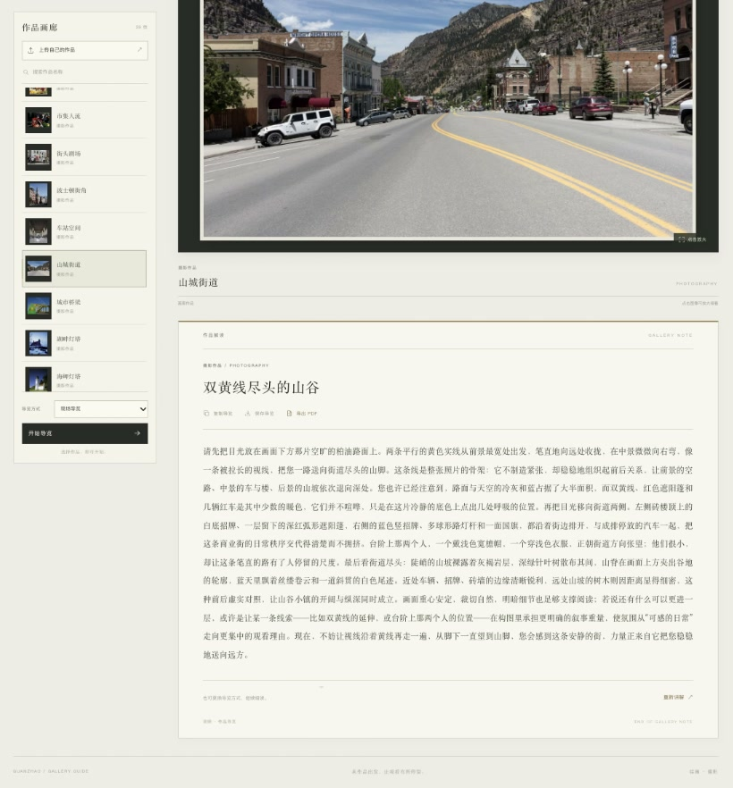
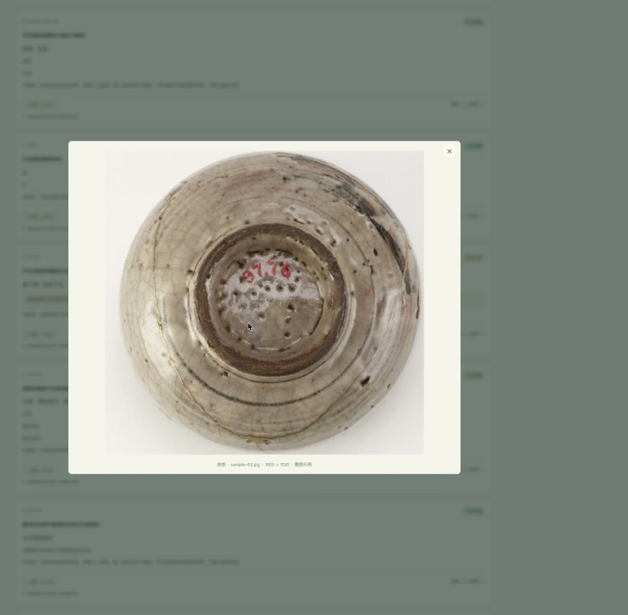
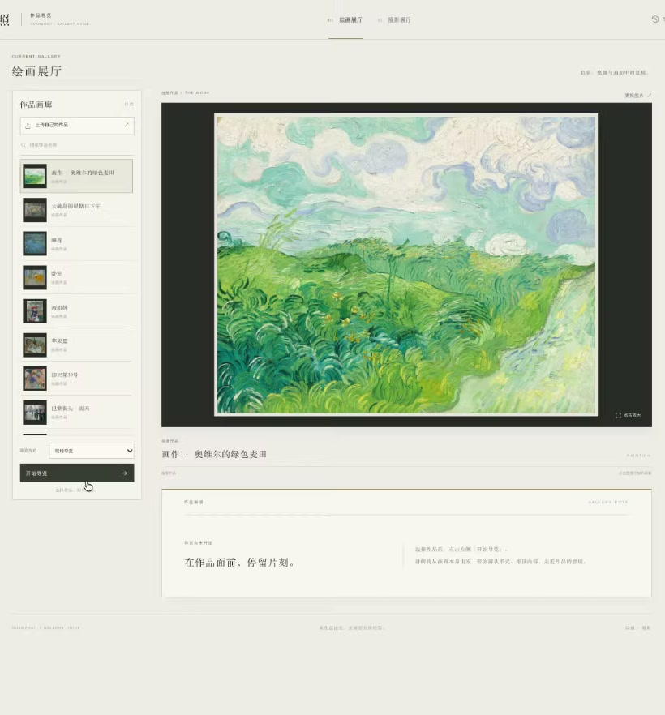
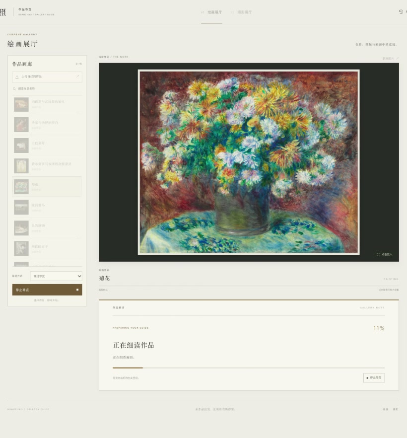
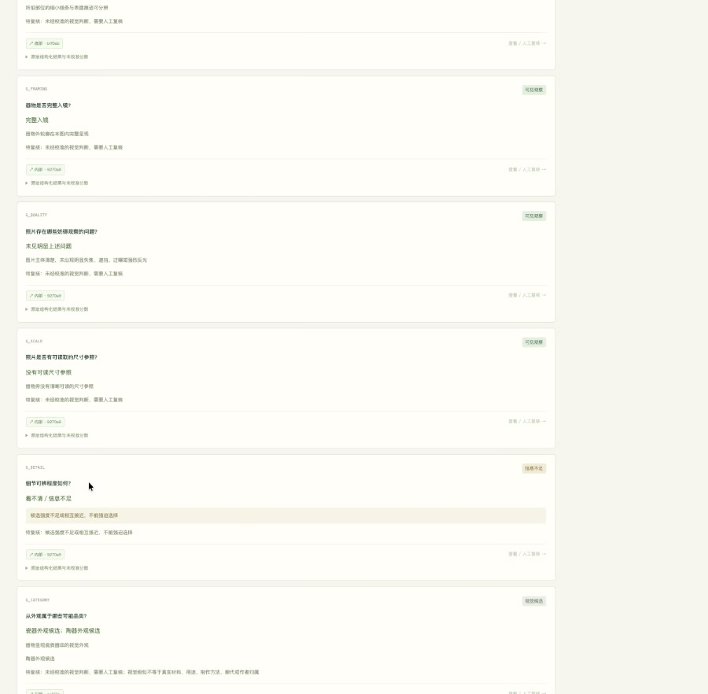
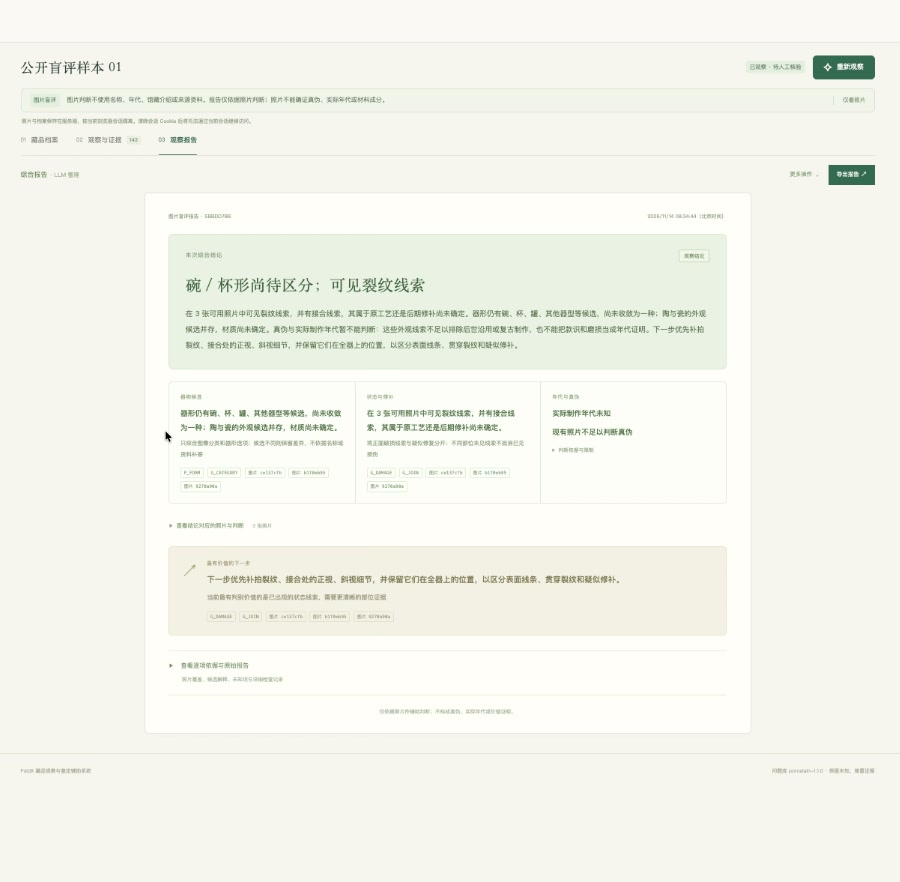

# 案例 07 · 艺术鉴赏与古董观察

[English](../en/cases/07-art.md)

**审美理解与细节鉴察 · 从看见细节，到理解美**

从绘画与摄影中的线条、色彩、构图和空间关系出发，尝试解释画面氛围；把细致观察延伸到器物图片，整理可见线索与需要继续核验的问题。

## 能力递进

从识别和比较推进到关系解读：观察细节如何共同形成视觉感受，以及它们能够支持怎样的初步判断。

## 演示视频

[观看视频 · 艺术鉴赏 · 原速 · 约 5 分 10 秒](../assets/cases/art/appreciation.mp4)

[观看视频 · 古董辅助观察 · 原速 · 约 1 分 53 秒](../assets/cases/art/antique.mp4)

## 应用价值

初步探索艺术观看辅助、作品解读、藏品记录与鉴定前的线索整理。

## 观察结果与证据边界

- 艺术演示将街景中的道路双黄线、山谷、建筑与色彩联系起来，形成氛围解读。
- 器物报告保留“碗／杯形尚待区分”等不确定性，提出补拍裂纹与接合处的建议。
- 古董界面标注综合报告由“LLM 整理”，呈现的是接入 Fold-X 的应用整体输出，不将全部报告文字归因为 Fold-X 单独生成。

初步展现艺术鉴赏的应用表现，未经专业能力评测；图片观察不能确认古董真伪、年代、材质或市场价值。

**速度口径：** 两段视频保留原速；录屏长度不代表单次判断或整份报告的生成延迟。

## 关键画面

### 观察绘画作品

### 观察色彩与构图

### 整理器物观察项

### 初步结论与补拍建议

古董观察展示视频已遮去确认弹窗中的服务连接信息；片段顺序、时长和结果内容保持不变。

[打开案例播放器](07-art.html) · [浏览全部案例](../index.html#cases) · [返回 GitHub 首页](../README.md)
