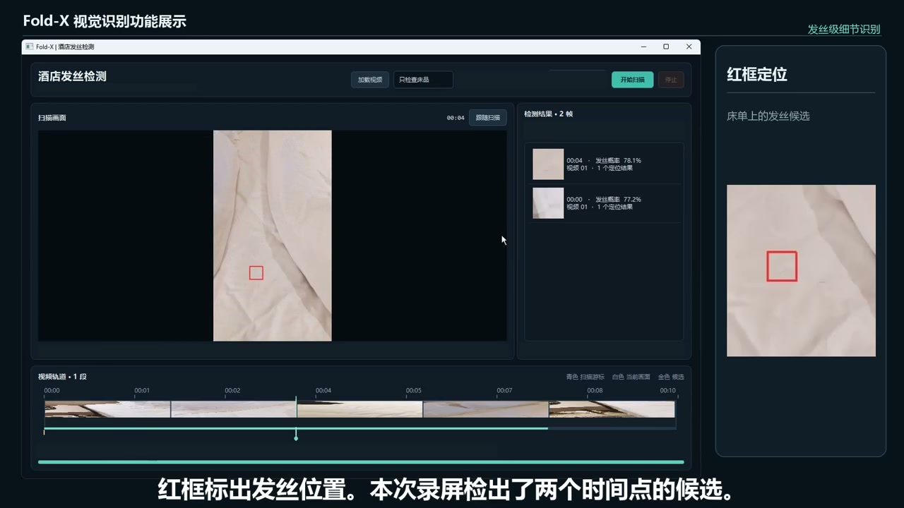
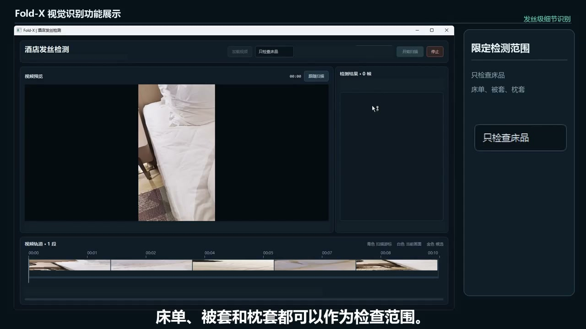
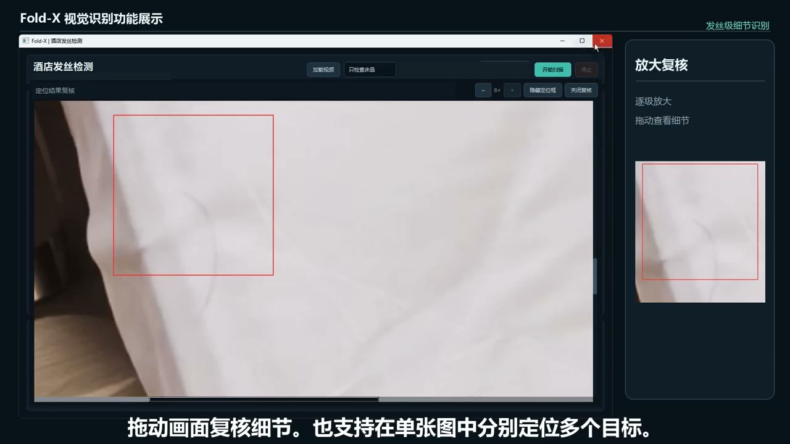

# 案例 08 · 床品质检：发丝检测

[English](../en/cases/08-fine-detail.md)

**精细视觉质检**

面向床品清洁质检，在纹理、褶皱与低对比度画面中发现疑似发丝，标出位置并放大复核。重点展示发现疑似问题、定位证据、辅助人工复核的视觉质检能力。

## 能力递进

从理解画面进一步走向质量检查：以细小异物检测为切入，判断哪些区域值得关注，并提供可复核的质检线索。

## 演示视频

[观看演示 · 约 46 秒](https://skywalkerhm.github.io/Fold-X/cases/08-fine-detail.html)

## 生产场景中的落地机会

把需要人工逐帧寻找的细节整理为候选位置，辅助复核与留档，为布草检查、纺织品异物筛查等场景提供试点方向。

- **酒店与布草检查**：筛出床单、被套等表面的发丝或异物候选，辅助清洁复核。
- **纺织品与表面质检**：探索细丝、异物和细小外观异常筛查，按材质与光照采集样本验证。
- **生产影像抽检与追溯**：将可疑画面与定位区域交给人员复核，保留时间点及检查依据。

## 观察结果与证据边界

- 演示先将检测范围限定为床品，再扫描视频并呈现候选结果。
- 结果列表显示两个时间点的候选，红框标出位置，可打开结果逐级放大查看。
- 画面中的候选评分不是标注数据上的准确率；本例不证明对所有细小目标均能可靠识别。

本例是功能演示，尚未提供生产现场的漏检率、误检率或吞吐验证；不将放大显示等同于提高原始画面分辨率。

**速度口径**：演示短片约 46 秒，包含剪辑与放大展示，不作为端到端检测耗时或毫秒级延迟的证据。

## 关键画面

### 限定床品检查范围

### 候选时间点与红框定位

### 放大复核低对比度细节

[浏览全部能力](https://skywalkerhm.github.io/Fold-X/#cases)
