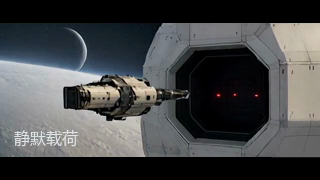
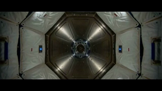
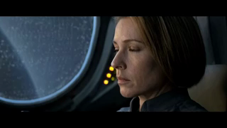
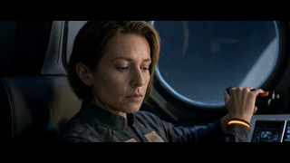

# 案例 09 · 一键视频生成 ·《静默载荷》

**视频生成与跨镜头一致性**

通过一段 50 秒科幻样片，展示一键视频生成的应用探索，重点观察跨镜头的人物外观、环境、光照与色彩衔接。

使用方反馈，系统可从长提示词一键生成连续视频，并改善人脸稳定性、环境衔接与色彩一致性。

[Watch / 观看样片](https://skywalkerhm.github.io/Fold-X/cases/09-video-generation.html)

可探索用于概念短片、分镜预演与创意样片制作，将展示范围从理解画面延伸到连续影像生成。

本例为生成结果样片，不是生成过程录屏。尚未提供原始提示词、生成操作记录和多样片质量评测，提示词上限、生成耗时及接缝或人脸变形发生率仍待实测。50 秒是成片播放时长，不是生成耗时。

