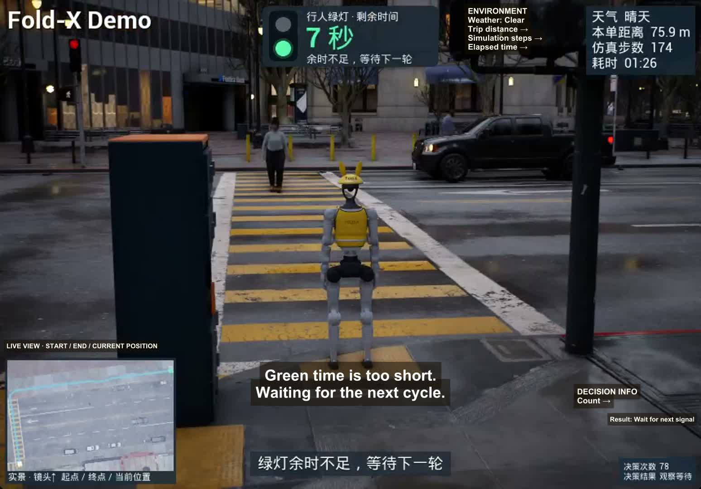
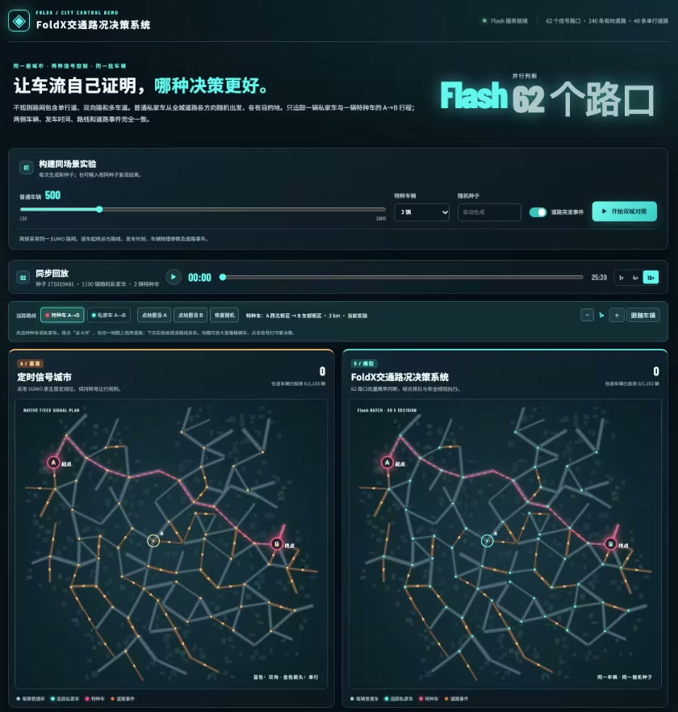
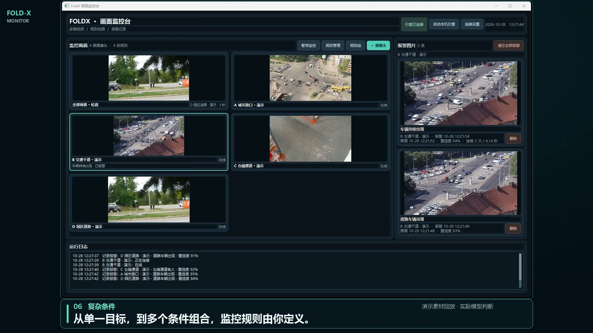
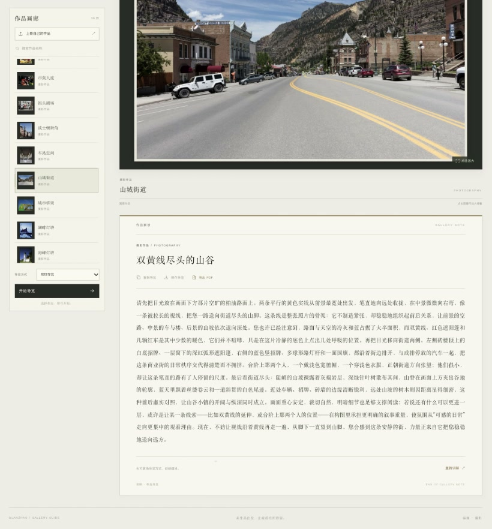

# Fold-X

[English](README.md) | [中文版](../README.md)

**Fold-X. Better decisions. Faster. For less.**

Fold-X is a multimodal decision model built for accuracy, speed, and efficiency. It turns text and images into judgments, choices, and scores your application can use. Flash-1.3 text and image APIs are available now.

[Request API access](docs/contact.md) · [API guide](docs/api.md) · [FAQ](docs/faq.md) · [Full showcase](https://skywalkerhm.github.io/Fold-X/en/index.html)

## 01 · Benchmark results

Full **DecisionBench 1.0 evaluation: 23,900 questions**. The following are author-submitted results. Flash and Light both completed every question with no recorded execution errors or unsupported items. Completion does not mean every answer was correct.

| Model | Accuracy | Reference position of submitted score | Source |
|---|---:|---:|---|
| **Fold-X Flash (9B)** | **76.85%** | **Between archived ranks 3–4** | [Submission #85](https://github.com/Hanno-Labs/decision-bench-results/pull/85) |
| **Fold-X Light (4B)** | **74.48%** | **Between archived ranks 5–6** | [Submission #82](https://github.com/Hanno-Labs/decision-bench-results/pull/82) |

[Task breakdown, comparisons, and ranking methodology →](benchmarks/decisionbench.md)

### Archived Top 10 · submitted scores shown separately

| Archived rank | Model / submitted version | Accuracy | Record source |
|---:|---|---:|---|
|1|Hanno-Labs/bosun-v3.1-1.7b|84.90%|[Archived main branch](https://github.com/Hanno-Labs/decision-bench-results/tree/e2d6a133cee91b9d8c6fbd076b21f32f3d75c81f)|
|2|Hanno-Labs/bosun-v3.1-0.6b|81.18%|[Archived main branch](https://github.com/Hanno-Labs/decision-bench-results/tree/e2d6a133cee91b9d8c6fbd076b21f32f3d75c81f)|
|3|mohit67890/imajev-4b|79.69%|[Archived main branch](https://github.com/Hanno-Labs/decision-bench-results/tree/e2d6a133cee91b9d8c6fbd076b21f32f3d75c81f)|
|**↳ Reference only**|**Fold-X Flash (9B · 1.3 Deep)**|**76.85%**|**[Submitted, not yet listed](https://github.com/Hanno-Labs/decision-bench-results/pull/85)**|
|4|EldanRing/Winnow-12B|76.65%|[Archived main branch](https://github.com/Hanno-Labs/decision-bench-results/tree/e2d6a133cee91b9d8c6fbd076b21f32f3d75c81f)|
|5|ekzhang/openjev-sglang|74.82%|[Archived main branch](https://github.com/Hanno-Labs/decision-bench-results/tree/e2d6a133cee91b9d8c6fbd076b21f32f3d75c81f)|
|**↳ Reference only**|**Fold-X Light (4B · 1.0 Deep)**|**74.48%**|**[Submitted, not yet listed](https://github.com/Hanno-Labs/decision-bench-results/pull/82)**|
|6|z-ai/glm-5.3-flash|74.09%|[Archived main branch](https://github.com/Hanno-Labs/decision-bench-results/tree/e2d6a133cee91b9d8c6fbd076b21f32f3d75c81f)|
|7|typesafe/jev-1.13|72.03%|[Archived main branch](https://github.com/Hanno-Labs/decision-bench-results/tree/e2d6a133cee91b9d8c6fbd076b21f32f3d75c81f)|
|8|deepseek/deepseek-v4.1-flash|71.00%|[Archived main branch](https://github.com/Hanno-Labs/decision-bench-results/tree/e2d6a133cee91b9d8c6fbd076b21f32f3d75c81f)|
|9|openai/gpt-5.6-luna|69.90%|[Archived main branch](https://github.com/Hanno-Labs/decision-bench-results/tree/e2d6a133cee91b9d8c6fbd076b21f32f3d75c81f)|
|10|razorback16/openjev|68.43%|[Archived main branch](https://github.com/Hanno-Labs/decision-bench-results/tree/e2d6a133cee91b9d8c6fbd076b21f32f3d75c81f)|

> **Fold-X Pro (27B) · >82%**
>
> **INTERNAL RESULT · FULL EVALUATION PENDING** — Internal text-judgment testing reports over 82%. A comparable full DecisionBench result has not been verified; this card is separate from score ordering and does not claim a leaderboard position or a submitted result.

The numbered rows are the Top 10 among 59 current entries in the November 14, 2026 main-branch archive. Flash and Light scores are inserted between adjacent scores for reference only: submitted, not yet listed, and excluded from leaderboard numbering. These are historical positions, not a live leaderboard.

## 02 · What Fold-X can do

Fold-X turns task information, goals, and constraints into decisions that an application can act on or review. Inputs may include text, images, or structured state information, depending on the service interface. After an action, the application can return the updated state for the next decision.

| Application area | The decision task |
|---|---|
| Text and business documents | Classification, condition checks, evidence verification, scoring, and multi-item review, with attention to context, references, and domain-specific language in Chinese |
| Images and video | Screening candidates using a description or reference image, locating video segments, and examining visual details |
| Ongoing action and coordination | Choosing the next step in games, simulations, and workflows, or coordinating connected decision points as conditions change |

**API workflow: provide the task and options → receive a decision → act and return the updated state.** Flash-1.3 currently provides text and image APIs. Contact the team about Light and Pro availability; benchmark versions are not necessarily online service versions. More complex applications require scenario-specific integration and evaluation. The application remains responsible for execution permissions, fallbacks, and human review.

## External evaluation

**An external evaluation reports 82.72% accuracy across 16 public benchmark samples totaling 1,574 questions.** In standard mode, Fold-X Pro places first or joint first on RTE, QQP, and TweetEval sentiment within the report’s three-model reference set. On a separate 231-question public decision set, adaptive mode reaches 85.28%.

These are results from an external evaluator, distinct from team-run tests. Positions use the report and archived comparison values; they are not official leaderboard rankings. The evaluation is dated November 3, 2026 and does not establish that the other models were rerun simultaneously.

[All 16 results, modes, response times, and evaluation limits](benchmarks/external-evaluation.md)

## Results in practical tasks

| Focus | Selected result | Scope |
|---|---|---|
| Accuracy | 89.32% vs. 79.59% on 936 classification questions | Historical team test against a same-sized model |
| Chinese understanding | 93.33% across 1,200 C-SEM questions | Flash deep configuration; public-set self-test |
| Speed | 75.5% less cumulative inference time on 1,213 questions | Local model timing, not end-to-end API latency |
| Efficiency | 10.5% lower estimated API cost in one batch workflow | Historical complete-workflow test, not a per-call saving |

An anonymized enterprise trial also reported fewer abstentions and errors. Its highly imbalanced sample limits the accuracy conclusion, so the comparison is presented with the majority-class baseline and measurement boundaries.

[Results, enterprise feedback, and limitations](benchmarks/product-results.md)

### Long-document retrieval and factual verification

| Task | Historical reported result | Configuration |
|---|---|---|
| Chinese passage retrieval · LongBench v1 | **100.0% (200/200)** | Flash · deep |
| English passage retrieval · LongBench v1 | **98.5%** | Flash · deep |
| English hallucination detection · RAGTruth | **F1 66.71%, 2,700 items** | Light · standard |

Team evaluation summary dated October 20, 2026. Scores apply to the specified tasks and configurations, not the entire benchmarks or the current API service. F1 is not accuracy. These are not official rankings or external certification.

[Full results, additional Chinese tasks, and limitations](benchmarks/product-results.md)

## Research behind the work

Three public preprints document the team's research on inference quality, efficiency evaluation, and mathematical task performance. They provide research context, rather than certification of the current Fold-X API or the seven demos.

- **[Virtual MoE — inference quality and reliability](https://arxiv.org/abs/2504.03739)**: studies inference quality and hallucination mitigation in a small-model setting. Its reported findings are specific to the evaluated model and tasks.
- **[SemanticFold — evaluating efficiency and capability together](https://arxiv.org/abs/2610.10304)**: examines whether different capability measures are preserved under compression. The measures can move in different directions; a gain in one does not establish a gain in all.
- **[Task presentation and execution paths shape LLM mathematical performance](https://arxiv.org/abs/2611.11102)**: studies how task presentation and available information affect mathematical answers, with paired comparisons showing task-dependent contributions.

These are arXiv preprints, not evidence of peer-review acceptance or independent product certification. Consult each paper for its experimental conditions and limitations. No unpublished implementation details are included here.

## 03 · Seven demos, a growing range of decisions

**Decision-making:** strategic judgment → timely action → complex environments → coordination across multiple decision points.

**Visual understanding:** language-guided scene understanding → reference-image recognition → aesthetic interpretation and close observation.

The first four cases explore how to act. The next three take a closer look at how visual information can inform a judgment. This is a narrative progression through applications, not a set of certified capability levels from a single benchmark.

Speed matters throughout: a decision needs to arrive in time to be useful. Playback speed, displayed throughput, model latency, and cloud API latency are reported separately rather than treated as interchangeable.

These recordings show application behavior. Individual runs, simulations, and momentary interface readings are not general accuracy or performance guarantees. The evidence limits are stated in each case. Videos and screenshots retain their original on-screen language and audio; the surrounding text and captions are in English.

### 01 · Go — Intelligence and strategic judgment

Fold-X Flash plays White against DeepSeek on a 19×19 Go board. The game shows a sequence of decisions that depend on the position, the available moves, and their consequences.

[Video and key frames](cases/01-go.md) · [Open player](https://skywalkerhm.github.io/Fold-X/en/cases/01-go.html)

### 02 · Super Mario — Fast, effective action selection

With enemies moving, terrain changing, and limited time to act, Fold-X repeatedly chooses whether to move, jump, or wait. The game runs on the left; the panel on the right shows the current state, selected action, and candidate scores.

[Video and key frames](cases/02-mario.md) · [Open player](https://skywalkerhm.github.io/Fold-X/en/cases/02-mario.html)

### 03 · Robot courier — Continuous decisions in complex environments

In an Unreal Engine delivery simulation, the robot receives a destination while environmental elements, pedestrians, and vehicles are placed randomly. Fold-X uses the information available at each step to decide whether to move, wait, or adjust its action.

[Video and key frames](cases/03-robot.md) · [Open player](https://skywalkerhm.github.io/Fold-X/en/cases/03-robot.html)

### 04 · Traffic signal coordination — Coordinating multiple decision points

Fold-X participates in signal decisions across 62 intersections as simulated traffic conditions change. Releasing traffic at one junction affects downstream roads, so each local choice needs to be considered in the context of the wider network.

[Video and key frames](cases/04-traffic.md) · [Open player](https://skywalkerhm.github.io/Fold-X/en/cases/04-traffic.html)

### 05 · Natural-language visual search — Connecting language to visual content

Describe an object, an activity, or a combination of conditions in natural language. Fold-X evaluates whether a scene matches. The monitoring application records matching frames, while video search returns candidate thumbnails and timestamps for review.

[Video and key frames](cases/05-visual.md) · [Open player](https://skywalkerhm.github.io/Fold-X/en/cases/05-visual.html)

### 06 · Reference-image search — Using an image to guide recognition and judgment

A reference image provides the visual target. The application compares it with an image collection or video frames, then displays candidates, scores, and video timestamps for review.

[Video and key frames](cases/06-image-search.md) · [Open player](https://skywalkerhm.github.io/Fold-X/en/cases/06-image-search.html)

### 07 · Art appreciation and antique observation — Aesthetic interpretation and attention to detail

The art demo explores how lines, color, composition, and spatial relationships shape the mood of paintings and photographs. The antique demo applies close visual observation to objects, distinguishing visible clues from questions that need further examination.

[Video and key frames](cases/07-art.md) · [Open player](https://skywalkerhm.github.io/Fold-X/en/cases/07-art.html)

## Get started

Request API access or discuss your task with [Mr. Liu — msfocus@gmail.com](mailto:msfocus@gmail.com) or [Mr. Huang — huangminl4@hotmail.com](mailto:huangminl4@hotmail.com).

[Contact details and phone numbers](docs/contact.md) · [API availability and usage](docs/api.md) · [FAQ](docs/faq.md)

General product questions can be posted in this repository’s **Issues** tab when enabled. Keep keys and customer data out of public messages. Use email for private conversations.

---

This repository contains product information, benchmark references, and demonstration media. Core implementation and model weights are not published here. Third-party media credits are listed in the relevant case notes.
