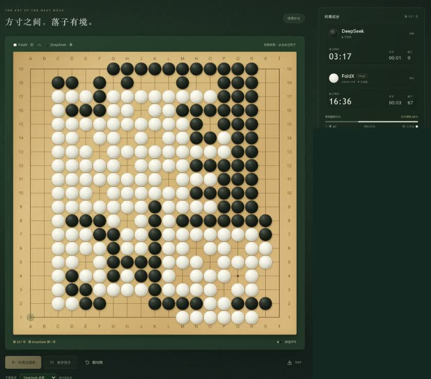
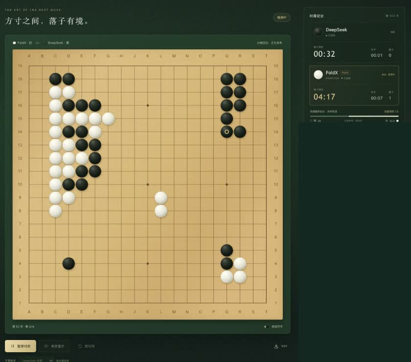
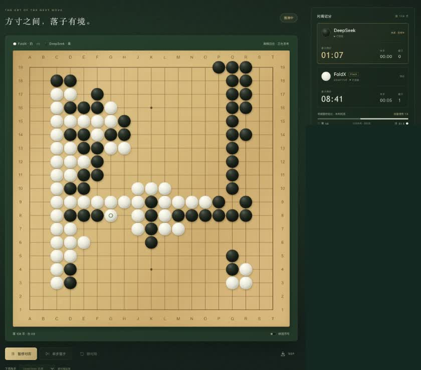

# Case 01 · Go

[English](./01-go.md) | [中文版](../../cases/01-go.md)

**Intelligence and strategic judgment — Read the board. Choose the next move.**

Fold-X Flash plays White against DeepSeek on a 19×19 Go board. The game shows a sequence of decisions that depend on the position, the available moves, and their consequences.

## The next step in the capability story

The starting point is strategic judgment: understanding a situation within a clear set of rules and choosing how to act.

## Watch the demo

[Watch · Go match · 5× playback · approx. 4 min 4 sec](../../assets/cases/go/fold-x-go-5x.mp4)

*Videos and screenshots retain their original on-screen language and audio.*

## Where this can help

A demonstration of the kind of judgment needed to compare options and weigh immediate gains against longer-term consequences.

## What the recording shows

- The final interface estimates a lead of 80.5 points for White. The specific DeepSeek version was not provided.
- The video preserves the order of play and focuses on the board and score display.

This is an interface estimate from one game, not an independently adjudicated result, a multi-game win rate, or a general intelligence benchmark.

**Reading the speed claims:** Playback is accelerated to 5× for viewing. This is not a measurement of model response speed.

## Key frames

### Opening moves

### The changing position in the middle game

[Open case player](https://skywalkerhm.github.io/Fold-X/en/cases/01-go.html) · [Explore all cases](https://skywalkerhm.github.io/Fold-X/en/index.html#cases) · [GitHub overview](../README.md)
