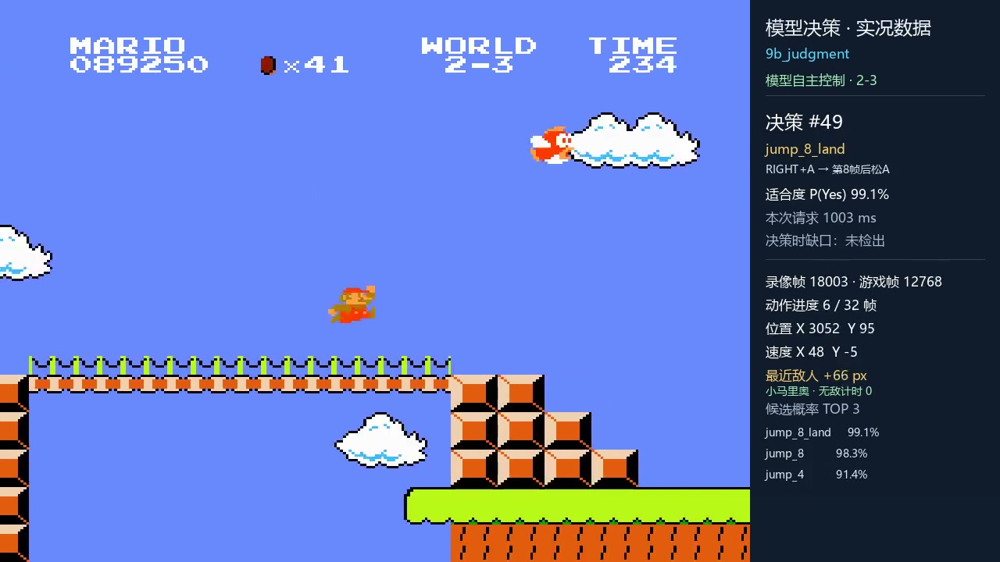
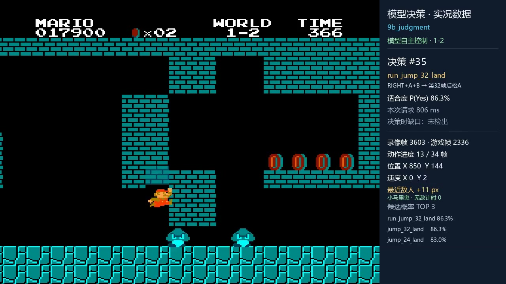
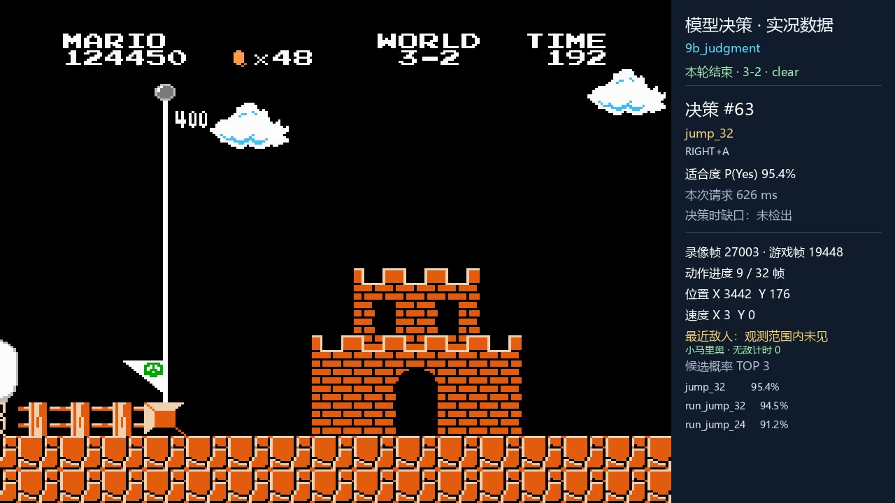
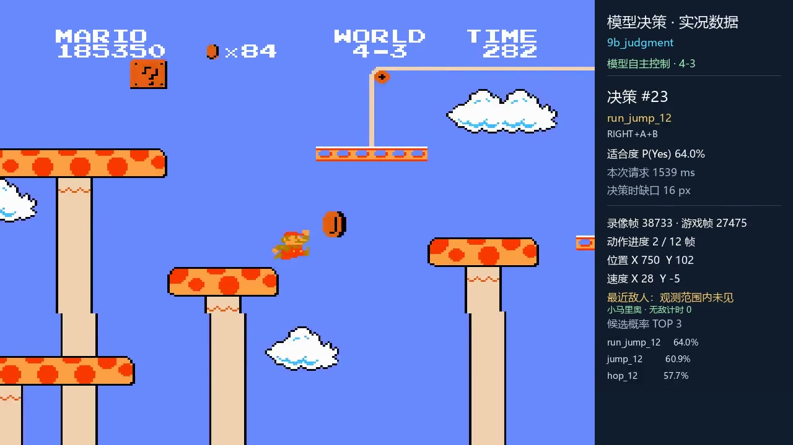

# Case 02 · Super Mario

[English](./02-mario.md) | [中文版](../../cases/02-mario.md)

**Fast, effective action selection — Act at the right moment.**

With enemies moving, terrain changing, and limited time to act, Fold-X repeatedly chooses whether to move, jump, or wait. The game runs on the left; the panel on the right shows the current state, selected action, and candidate scores.

## The next step in the capability story

Strategy now meets timing: as the environment changes, a useful decision must become an effective action quickly enough to matter.

## Watch the demo

[Watch · Super Mario · 5× playback · approx. 4 min 19 sec](../../assets/cases/mario/fold-x-mario-5x.mp4)

*Videos and screenshots retain their original on-screen language and audio.*

## Where this can help

Relevant to game agents, interactive applications, and action selection in systems with continuous feedback.

## What the recording shows

- The recording shows continuous play across several levels and ends during World 4-3.
- The right-hand panel summarizes state and decisions. Candidate scores are not measured accuracy or probabilities of completing the game.

The recording illustrates action timing and outcomes. It does not establish a success rate across repeated runs, completion of the entire game, or control from raw pixels alone.

**Reading the speed claims:** The full recording is shown at 5× speed. Actual request latency must be measured from run logs, not inferred from playback.

## Key frames

### Current state and the selected action

### Reaching the flagpole in World 3-2

### Still playing in World 4-3 near the end

The public edit retains the game, current state, and action choices. Technical annotations at the bottom of the side panel are obscured.

[Open case player](02-mario.html) · [Explore all cases](../index.html#cases) · [GitHub overview](../README.md)
