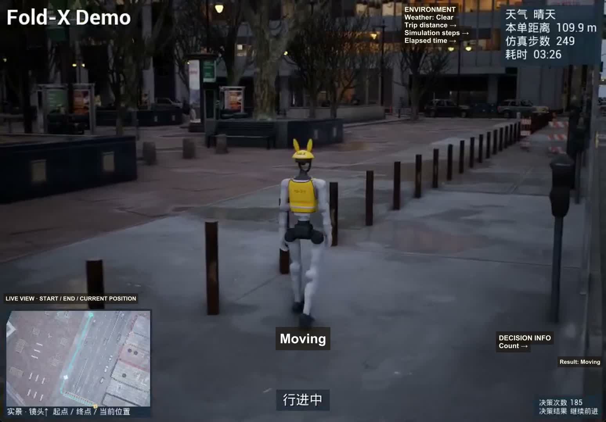

# Case 03 · Robot courier

[English](./03-robot.md) | [中文版](../../cases/03-robot.md)

**Continuous decisions in complex environments — Adapt to the world as it changes.**

In an Unreal Engine delivery simulation, the robot receives a destination while environmental elements, pedestrians, and vehicles are placed randomly. Fold-X uses the information available at each step to decide whether to move, wait, or adjust its action.

## The next step in the capability story

Beyond timing a single action, the robot must consider several factors together: its goal, pedestrians, vehicles, signals, and whether the route is clear.

## Watch the demo

[Watch · Robot courier · original speed · approx. 4 min 7 sec](../../assets/cases/robot/fold-x-robot-delivery.mp4)

*Videos and screenshots retain their original on-screen language and audio.*

## Where this can help

An exploration of how robots could interact with the world: observe a changing situation, respond in pursuit of a goal, and adjust as new information arrives.

## What the recording shows

- Project materials identify the virtual robot asset as a Unitree G9 model. This naming follows the project documentation.
- The recording includes waiting when too little green-light time remains, stopping at the curb on red, and proceeding after conditions change.
- According to the project team, no pretraining was performed specifically for this delivery scenario or route. This does not mean the underlying model was never trained.

This is an Unreal Engine simulation. It does not establish deployment on a physical robot, completion of the full delivery, or human-equivalent behavior.

**Reading the speed claims:** The video retains its original playback speed. Recording length is not per-decision latency.

## Key frames

### The virtual neighborhood and task environment

### Monitoring pedestrians and the traffic signal

### Moving on when conditions allow

[Open case player](03-robot.html) · [Explore all cases](../index.html#cases) · [GitHub overview](../README.md)
