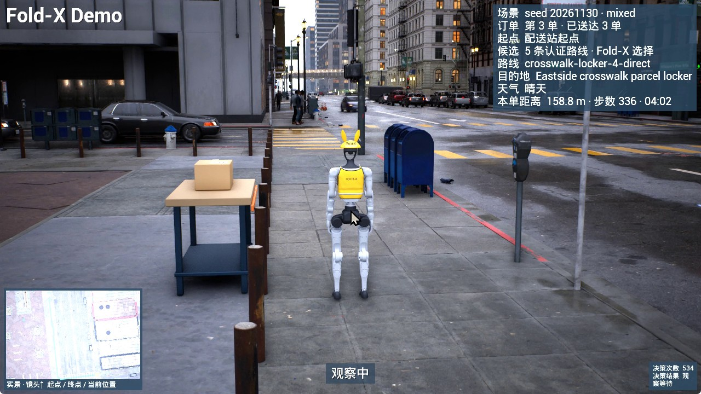
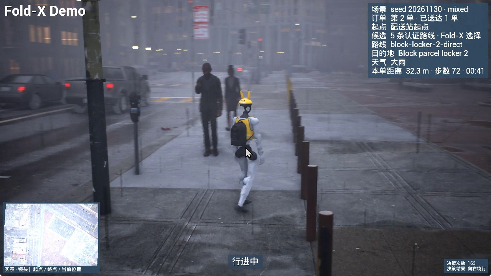

# Case 03 · Robot delivery

[中文版](../../cases/03-robot.md)

**Decisions in complex environments**

In an Unreal Engine city simulation, Fold-X makes ongoing decisions using weather, pedestrians, vehicles, signals, and task progress, completing three deliveries and returning to the station after each. The updated demo adds randomized scenario changes and incorporates their effects on visibility, passage conditions, and interactions into decision-making.

## The next step in the capability story

Beyond choosing a timely action, the robot follows a complete task cycle in changing conditions: depart, assess the situation, deliver, return, and begin the next order.

## What is new in this demo

- Randomized changes inform decisions: weather changes and dynamic pedestrian and vehicle states update the information Fold-X uses to move, wait, or adjust. Execution remains subject to safety constraints.
- From a short segment to complete tasks: the recording covers three deliveries and three returns, including outbound and return road crossings.
- Interaction during a task: Fold-X decides whether and when to respond to a pedestrian based on the current situation. An external language model generates the dialogue text.

## Watch the demo

Three deliveries and returns · 5× speed · approx. 4 min

Separate curb-handling check · 5× speed · approx. 29 sec

## Where this can help

Explore continuous task decisions for campus delivery, inspection, and service robots: adjust actions toward a goal as conditions change and interactions interrupt the journey.

## What the recording shows

- Complete three-order baseline: three deliveries and three returns. Logs record no pedestrian or vehicle contact and one static curb contact.
- Separate curb-handling check: one delivery and return, one proactive step-up, and no recorded contact. This is not a zero-contact rerun of all three orders after the fix.
- The randomized scenario mechanism and the flow of observed conditions into decisions were checked. No random starting point was triggered in this run, and aggregate results across random seeds are not yet available.

This is a single Unreal Engine simulation run, not physical-robot deployment or a success-rate study across randomized trials. Routes are chosen from a predefined set of candidates; this is not unrestricted autonomous exploration.

Both videos play at 5× speed. The full recording is about 20 minutes, shown in about 4 minutes; the separate check is about 2 minutes 24 seconds, shown in about 29 seconds. Playback duration is neither actual task duration nor per-decision latency.

## Key frames

### Reaching the delivery point

### Dialogue and the current situation

### Three orders completed and return to station

### Reviewing the separate curb-handling check

[↩ All capabilities](../index.html#cases)
