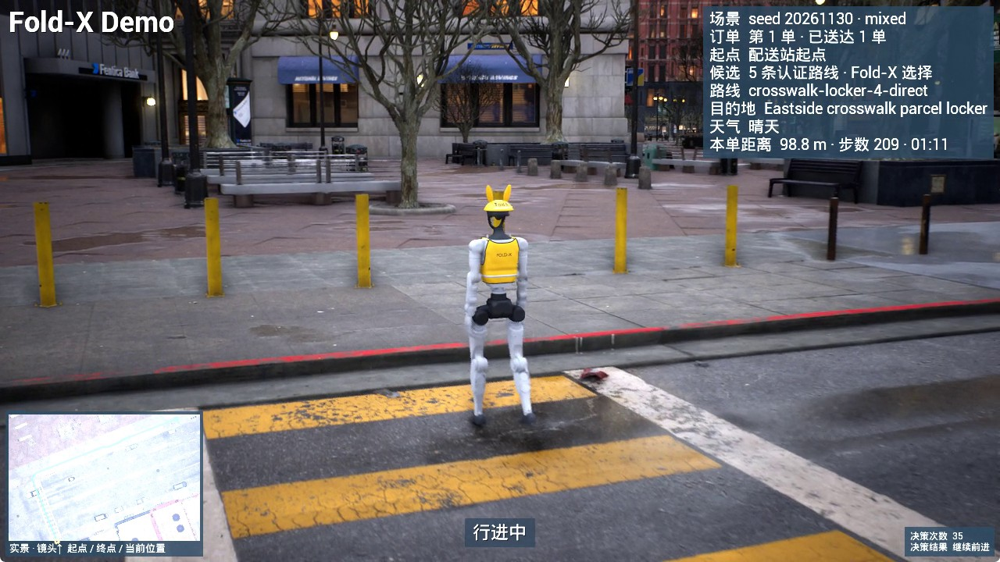
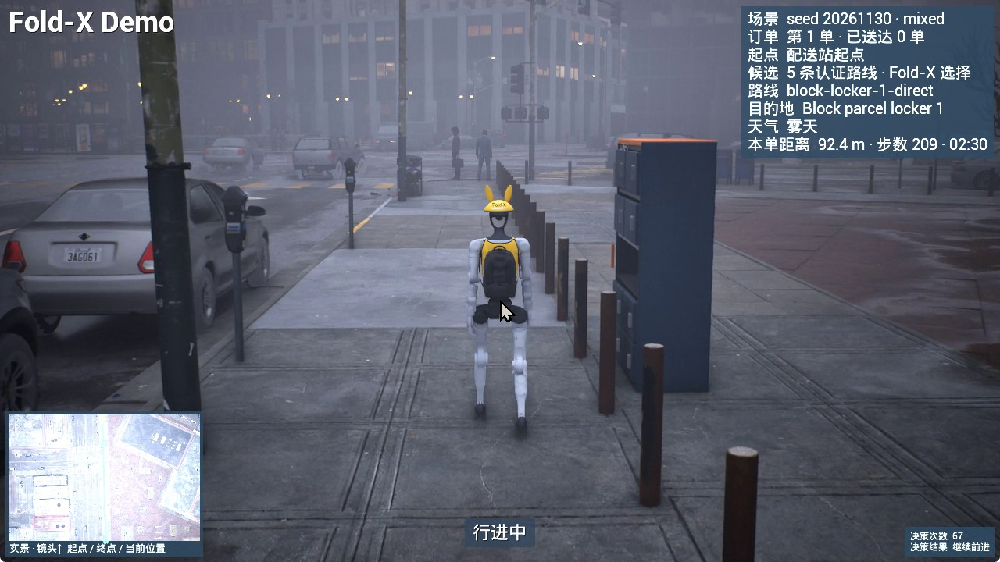
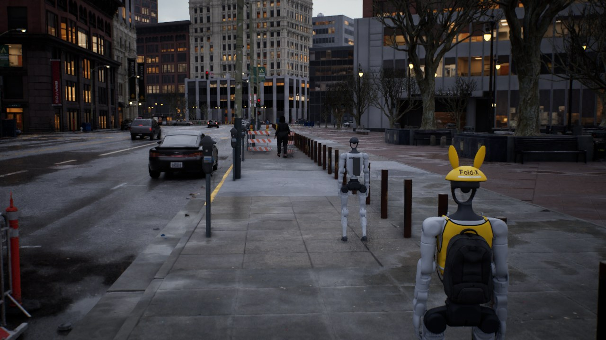
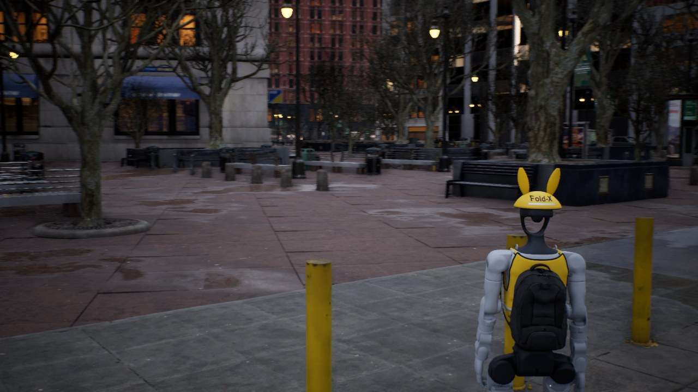
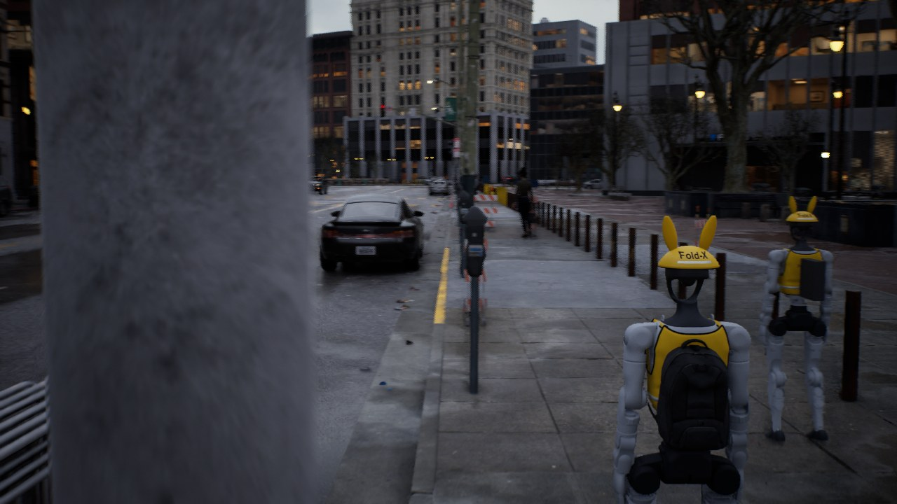
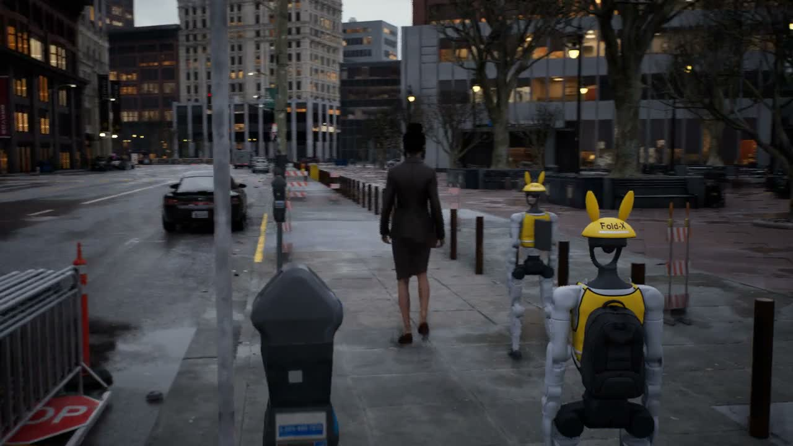

# Case 03 · Robot delivery

[中文版](../../cases/03-robot.md)

**Decisions in complex environments**

In an Unreal Engine city simulation, Fold-X makes ongoing decisions using weather, pedestrians, vehicles, signals, and task progress, completing three deliveries and returning to the station after each. Randomized changes in the scenario—and their effects on visibility, passage conditions, and interactions—inform ongoing decisions.

## The next step in the capability story

Beyond choosing a timely action, the robot follows a complete task cycle in changing conditions: depart, assess the situation, deliver, return, and begin the next order.

## Decision-making in this scenario

- Randomized changes inform decisions: weather changes and dynamic pedestrian and vehicle states update the information Fold-X uses to move, wait, or adjust. Execution remains subject to safety constraints.
- Complete task execution: the recording covers three deliveries and three returns, including outbound and return road crossings.
- Interaction during a task: Fold-X decides whether and when to respond to a pedestrian based on the current situation. An external language model generates the dialogue text.

## Watch the demo

Three deliveries and returns · 5× speed · approx. 4 min

Separate curb-handling check · 5× speed · approx. 29 sec

## Where this can help

Explore continuous task decisions for campus delivery, inspection, and service robots: adjust actions toward a goal as conditions change and interactions interrupt the journey.

## What the recording shows

- Complete three-order recording: three deliveries and three returns. Logs record no pedestrian or vehicle contact and one static curb contact.
- Separate curb-handling check: one delivery and return, one proactive step-up, and no recorded contact. These results apply only to this separate run.
- The randomized scenario mechanism and the flow of observed conditions into decisions were checked. No random starting point was triggered in this run, and aggregate results across random seeds are not yet available.

This is a single Unreal Engine simulation run, not physical-robot deployment or a success-rate study across randomized trials. Routes are chosen from a predefined set of candidates; this is not unrestricted autonomous exploration.

Both videos play at 5× speed. The full recording is about 20 minutes, shown in about 4 minutes; the separate check is about 2 minutes 24 seconds, shown in about 29 seconds. Playback duration is neither actual task duration nor per-decision latency.

## Key frames

### Reaching the delivery point

### Dialogue and the current situation

### Three orders completed and return to station

### Reviewing the separate curb-handling check

## Follow a target. Adapt along the way. Complete the delivery.

In an Unreal Engine city simulation, Fold-X supports identifying and following a designated guide, maintaining task continuity when the target is temporarily occluded, and choosing whether to continue, slow down, or wait and observe until delivery is complete.

Explore guided transport, assistance, and collaborative delivery by combining goal-directed movement with leader–follower coordination.

Generic-person following · Original speed

Following across a signal-controlled crossing · Original speed

Complex map · 1.3× crowd level · Original speed

Complex map · 1.5× crowd pressure test · Original speed

These are four recorded scenario runs. The source summaries were checked; the experiments were not rerun for this publication. All three primary scenarios recorded completed delivery and no contact, but the generic-person scenario failed its following-distance check. The pressure test is reported separately; these results do not establish a general success rate or safety guarantee.

|Scenario|Delivery completed|Contact events|Observed distance (m)|Distance check|
|---|---|---:|---|---|
|Generic-person following|Yes|0|2.253–9.492|Failed|
|Following across a signal-controlled crossing|Yes|0|2.137–4.316|Passed|
|Complex map · 1.3× crowd level|Yes|0|2.329–3.199|Passed|
|Complex map · 1.5× crowd pressure test|Yes|1|2.054–7.362|Failed|

The crossing scenario cleared nearby pedestrians at the curb. Its result cannot be combined with the crowd scenario as evidence of dense-crowd crossing. Only video and a summary were supplied for the pressure test. Execution remains subject to safety constraints; these are system-level simulation results, not physical-robot deployment evidence.

These short recordings retain their original playback speed: approximately 33, 72, 23, and 36 seconds. The recording rate of about 4 FPS is not the model inference or control frequency.

[↩ All capabilities](../index.html#cases)
