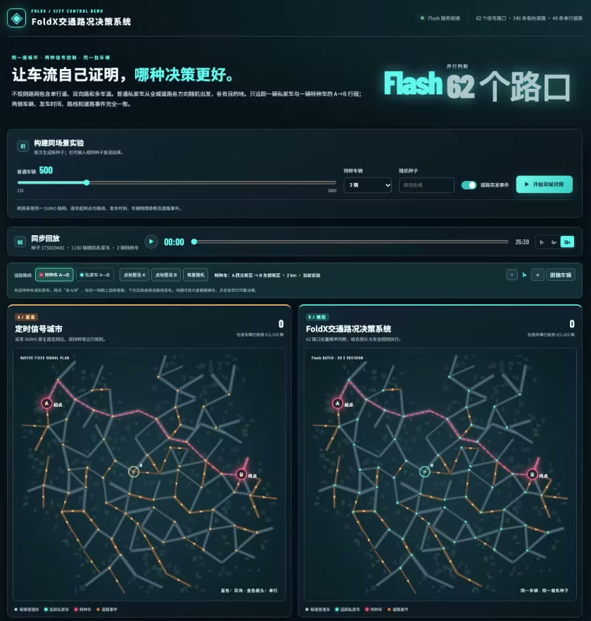
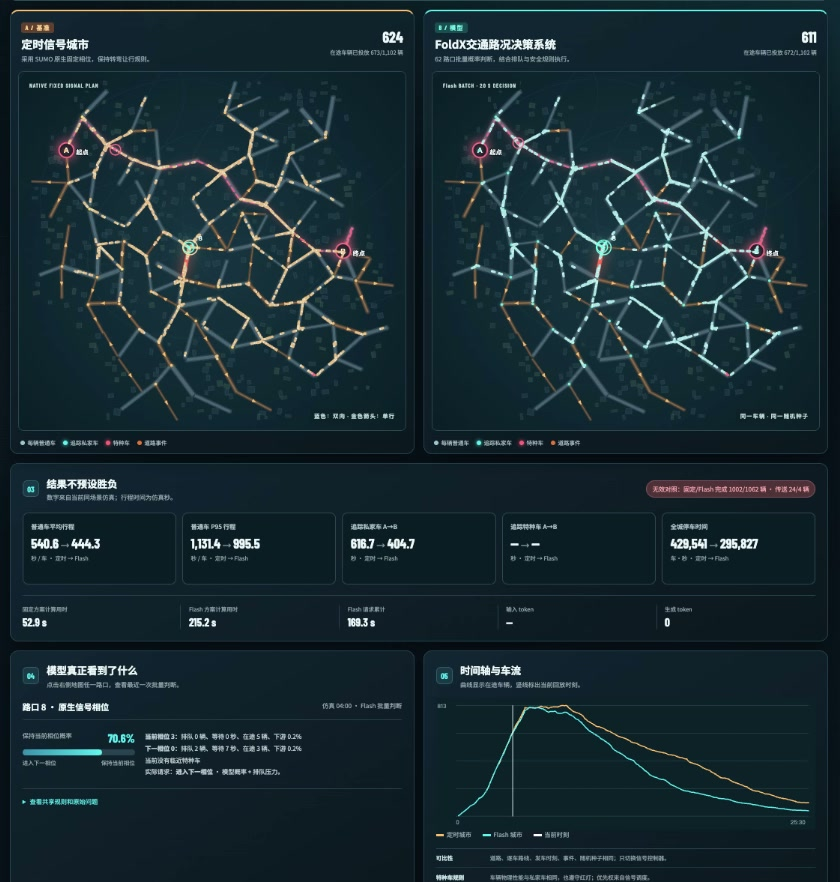
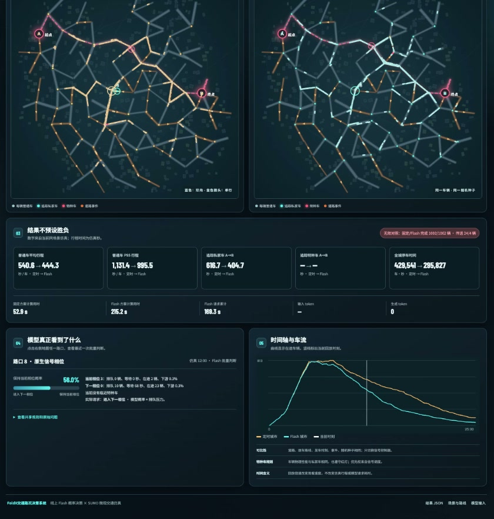
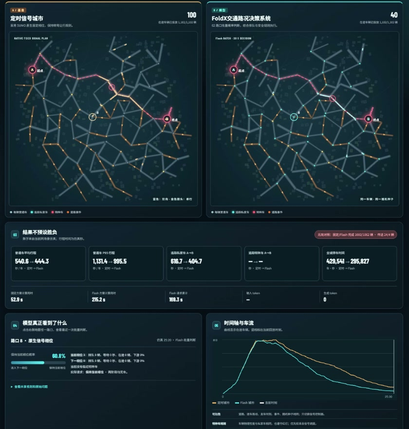

# Case 04 · Traffic signal coordination

[English](./04-traffic.md) | [中文版](../../cases/04-traffic.md)

**Coordinating multiple decision points — Keep 62 intersections working together.**

Fold-X participates in signal decisions across 62 intersections as simulated traffic conditions change. Releasing traffic at one junction affects downstream roads, so each local choice needs to be considered in the context of the wider network.

## The next step in the capability story

The scope expands from one acting agent to multiple connected decision points, each with local demands and consequences for the rest of the system.

## Watch the demo

[Watch · 62-intersection coordination · approx. 1 min 50 sec](../../assets/cases/traffic/fold-x-traffic-62.mp4)

*Videos and screenshots retain their original on-screen language and audio.*

## Where this can help

A functional demonstration relevant to network coordination, resource allocation, and ongoing scheduling decisions.

## What the recording shows

- The simulation shows continuing decisions across 62 intersections as traffic conditions evolve.
- The interface labels this run as an invalid comparison. No traffic-efficiency improvement is claimed from it.

This is a simulation and replay, not evidence of a city deployment or global optimality. It also does not establish that all 62 decisions are made in a single API call.

**Reading the speed claims:** The recording has not been further accelerated. The application itself displays a 16× replay speed, which cannot be used to infer decision throughput.

## Key frames

### Traffic moving between connected junctions

### Local choices and subsequent changes

### Final state and comparison status

[Open case player](04-traffic.html) · [Explore all cases](../index.html#cases) · [GitHub overview](../README.md)
