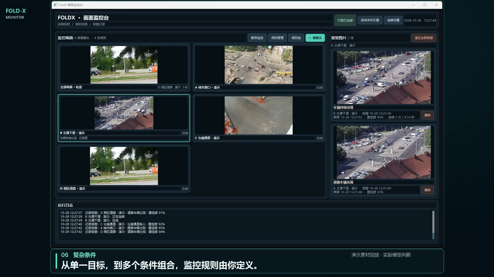
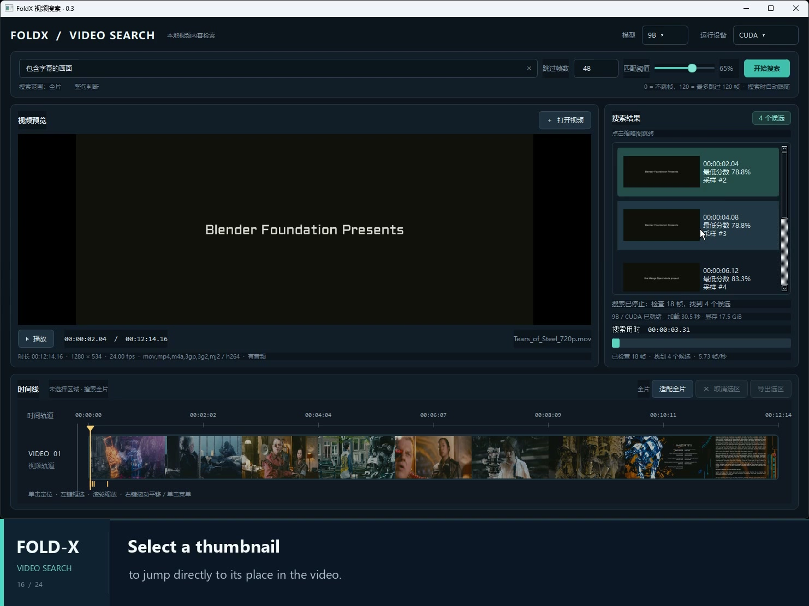
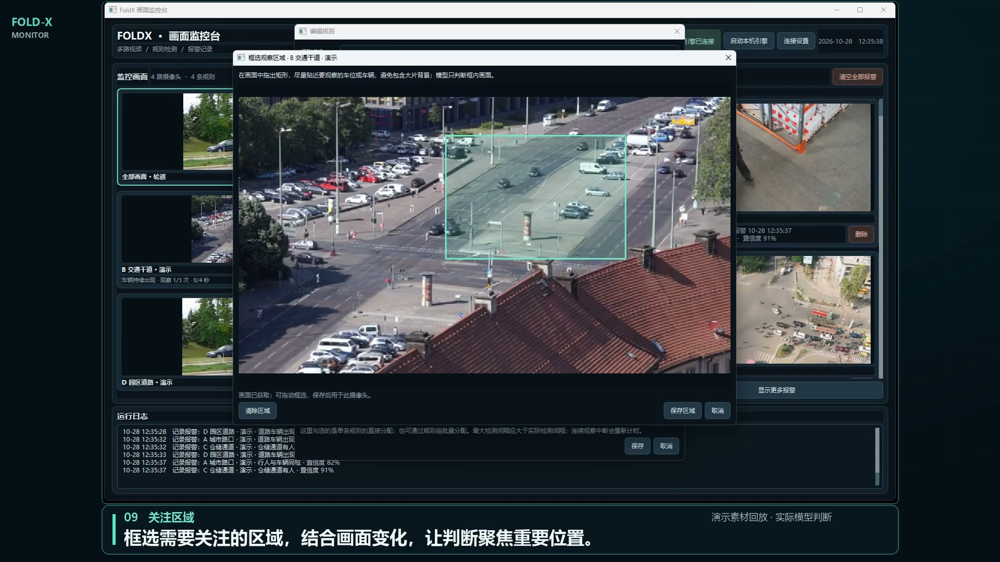
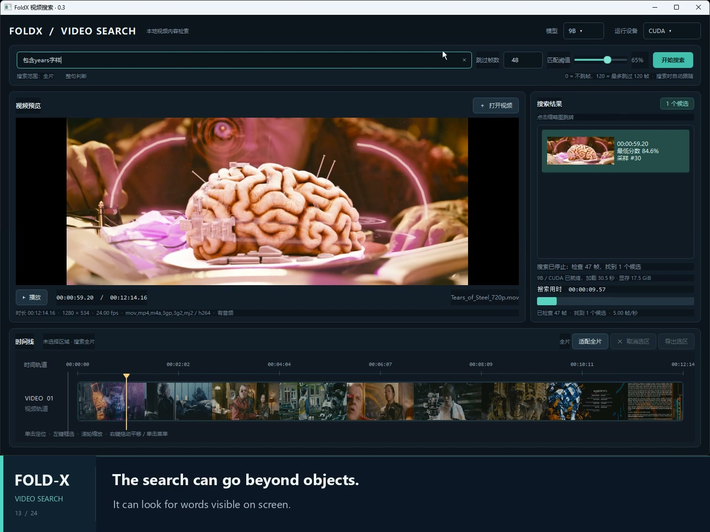

# Case 05 · Natural-language visual search

[English](./05-visual.md) | [中文版](../../cases/05-visual.md)

**Connecting language to visual content — Describe what you want to find.**

Describe an object, an activity, or a combination of conditions in natural language. Fold-X evaluates whether a scene matches. The monitoring application records matching frames, while video search returns candidate thumbnails and timestamps for review.

## The next step in the capability story

The focus shifts to visual understanding: connecting a goal expressed in words with specific content in an image or video.

## Watch the demo

[Watch · Visual monitoring · approx. 1 min 26 sec](../../assets/cases/visual/monitor-promo-public.mp4)

[Watch · Video search · approx. 3 min 37 sec](../../assets/cases/visual/search-english-public.mp4)

*Videos and screenshots retain their original on-screen language and audio.*

## Where this can help

Relevant to event screening, video content search, and capturing frames that meet user-defined conditions.

## What the recording shows

- The demos include combined conditions, regions of interest, match records, and navigation to video timestamps.
- The monitoring demo replays sample footage. Match scores are not accuracy measured against labeled ground truth.

These recordings demonstrate the workflow. They do not include a complete accuracy evaluation or reproducible per-decision latency measurements.

**Reading the speed claims:** Project materials describe the frame-level judgment step as taking milliseconds. That claim has not been independently verified here and is not a promise of millisecond full-video search or cloud API latency.

## Key frames

### Defining a condition in natural language

### Selecting a region of interest

### Reviewing candidate frames

Both public edits retain the original sequence and audio of the included scenes. Technical explanation segments have been removed.

## Media credits

- Music: “Universal” by Kevin MacLeod, [incompetech.com](https://incompetech.com/), licensed under [CC BY 4.0](https://creativecommons.org/licenses/by/4.0/). The original includes duration and volume edits; the public version includes further cuts with the video.
- Sample film: “Tears of Steel” by Blender Foundation, [mango.blender.org](https://mango.blender.org/), licensed under [CC BY 3.0](https://creativecommons.org/licenses/by/3.0/). Videos and screenshots contain excerpts.
- Monitoring footage: the original credits identify it as replayed Pexels footage.

[Open case player](https://skywalkerhm.github.io/Fold-X/en/cases/05-visual.html) · [Explore all cases](https://skywalkerhm.github.io/Fold-X/en/index.html#cases) · [GitHub overview](../README.md)
