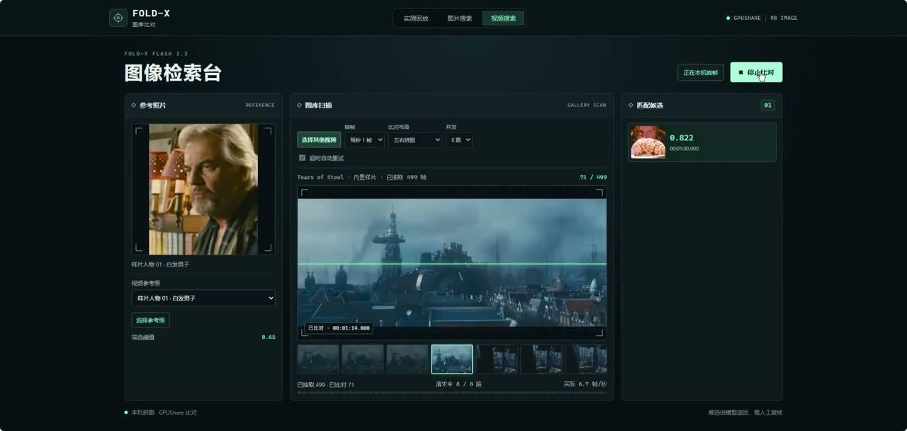
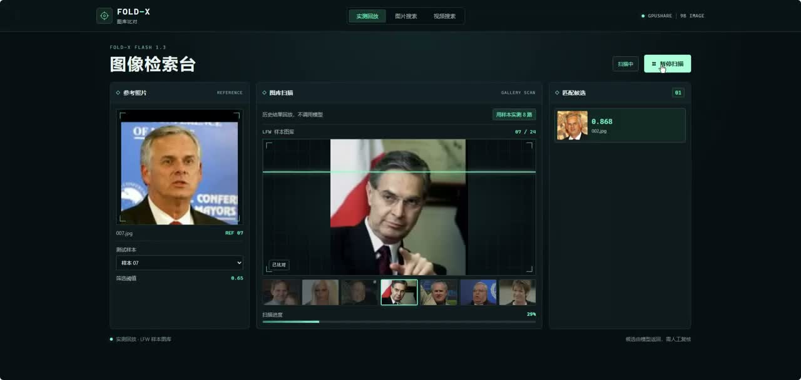
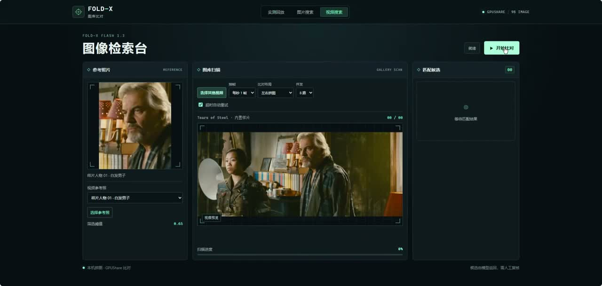
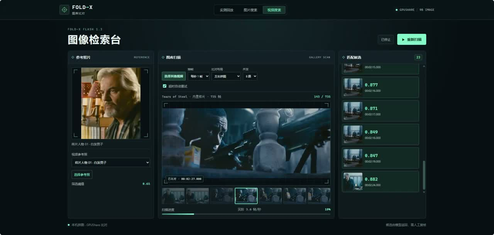

# Case 06 · Reference-image search

[English](./06-image-search.md) | [中文版](../../cases/06-image-search.md)

**Using an image to guide recognition and judgment — Show what you mean. Find related scenes.**

A reference image provides the visual target. The application compares it with an image collection or video frames, then displays candidates, scores, and video timestamps for review.

## The next step in the capability story

Words are no longer the only way to express the target. The next step is to interpret a reference image and judge how other scenes relate to it.

## Watch the demo

[Watch · Reference-image search · original speed · 1 min 6 sec](../../assets/cases/image-search/fold-x-image-search.mp4)

*Videos and screenshots retain their original on-screen language and audio.*

## Where this can help

Relevant to finding visual assets, screening image libraries, and locating candidate video segments.

## What the recording shows

- The image section replays historical results. The video scan ends at 143 of 735 frames, about 19% complete, with 23 candidates displayed.
- Candidates still require review. Match accuracy has not been independently evaluated.

This is a demonstration of a partial scan, not evidence of full-search duration, accuracy, or an advantage over other models.

**Reading the speed claims:** At one point, the interface reports 6.7 frames per second. This is a momentary reading, not average throughput over the full run or per-decision model latency.

## Key frames

### Replaying historical image-search results

### Setting the reference image

### Candidates and their timestamps

[Open case player](https://skywalkerhm.github.io/Fold-X/en/cases/06-image-search.html) · [Explore all cases](https://skywalkerhm.github.io/Fold-X/en/index.html#cases) · [GitHub overview](../README.md)
