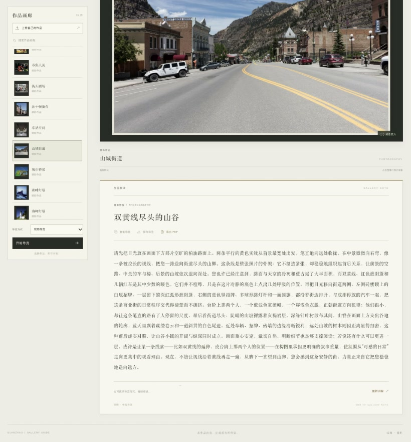
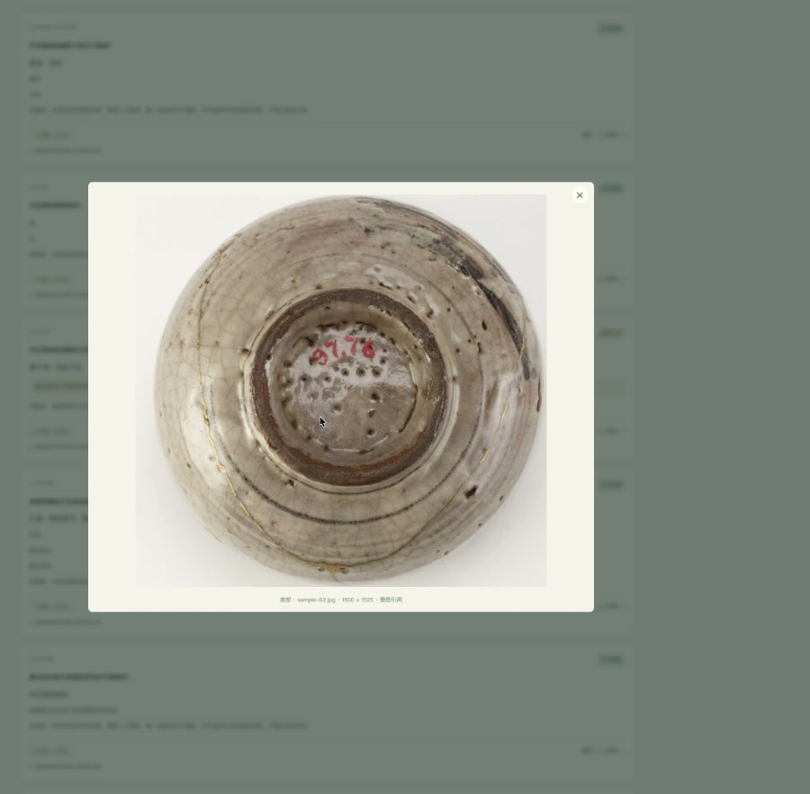
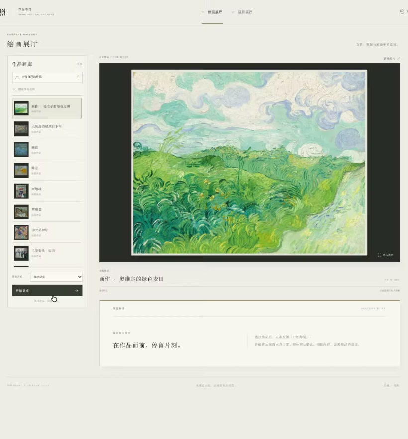
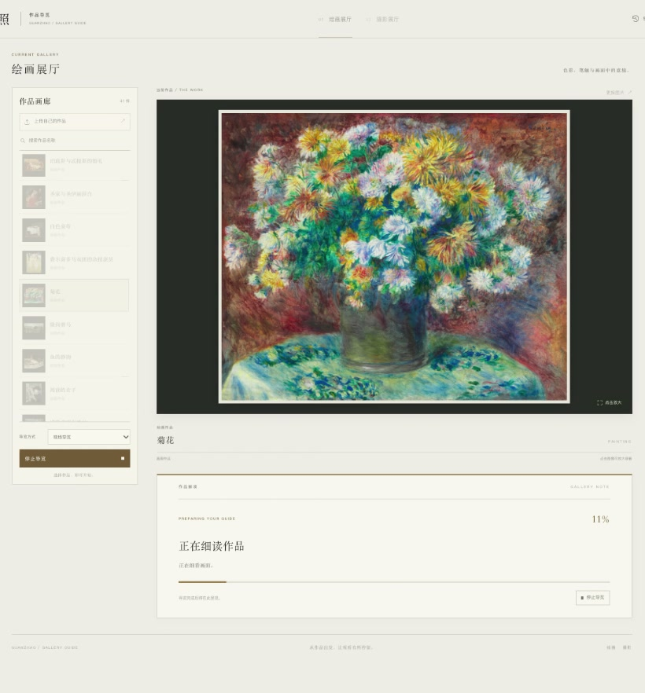
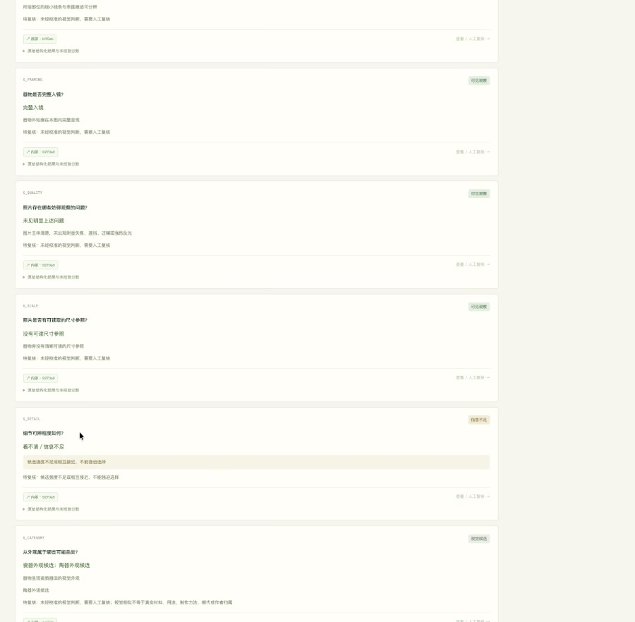
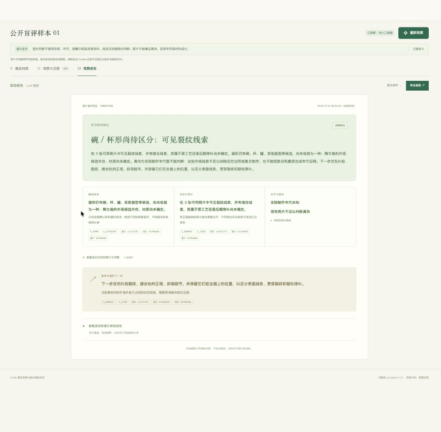

# Case 07 · Art appreciation and antique observation

[English](./07-art.md) | [中文版](../../cases/07-art.md)

**Aesthetic interpretation and attention to detail — From noticing details to interpreting beauty.**

The art demo explores how lines, color, composition, and spatial relationships shape the mood of paintings and photographs. The antique demo applies close visual observation to objects, distinguishing visible clues from questions that need further examination.

## The next step in the capability story

Recognition and comparison lead to interpretation: how do details work together to create a visual impression, and what tentative conclusions can they support?

## Watch the demo

[Watch · Art appreciation · original speed · approx. 5 min 10 sec](../../assets/cases/art/appreciation.mp4)

[Watch · Antique observation · original speed · approx. 1 min 53 sec](../../assets/cases/art/antique.mp4)

*Videos and screenshots retain their original on-screen language and audio.*

## Where this can help

An early exploration of guided art viewing, artwork interpretation, collection documentation, and organizing clues before expert appraisal.

## What the recording shows

- The art demo connects road markings, a valley, buildings, and color in a street photograph to an interpretation of its atmosphere.
- The object report leaves questions open, including whether the vessel is a bowl or cup, and recommends close-up photographs of cracks and joints.
- The antique interface labels the combined report as organized by an LLM. The demo therefore shows the output of an application using Fold-X; it does not attribute all report text to Fold-X alone.

These are early demonstrations of art appreciation, not a professional competency assessment. Images alone do not establish an antique’s authenticity, age, material, or market value.

**Reading the speed claims:** Both videos retain their original playback speed. Recording length is not the latency of a single judgment or the time taken to generate a complete report.

## Key frames

### Viewing a painting

### Exploring color and composition

### Organizing observations about an object

### Tentative findings and requests for more photographs

The public antique video obscures connection details in a confirmation dialog. The sequence, duration, and displayed findings are unchanged.

[Open case player](https://skywalkerhm.github.io/Fold-X/en/cases/07-art.html) · [Explore all cases](https://skywalkerhm.github.io/Fold-X/en/index.html#cases) · [GitHub overview](../README.md)
