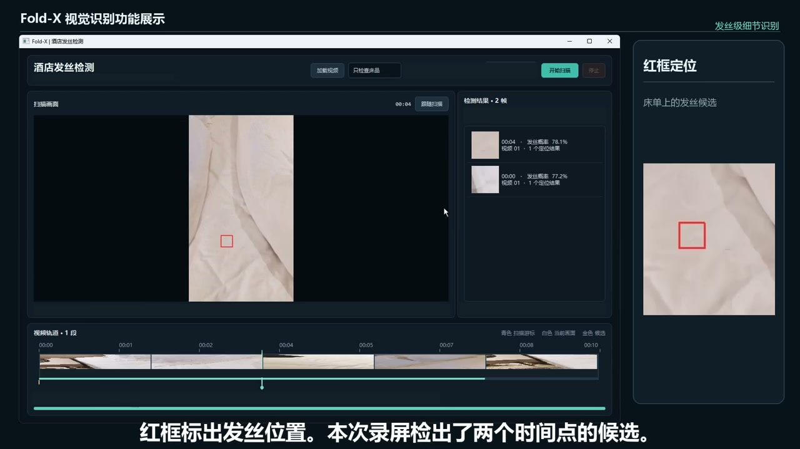
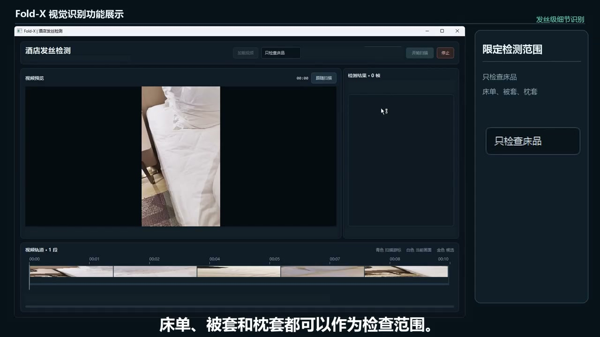
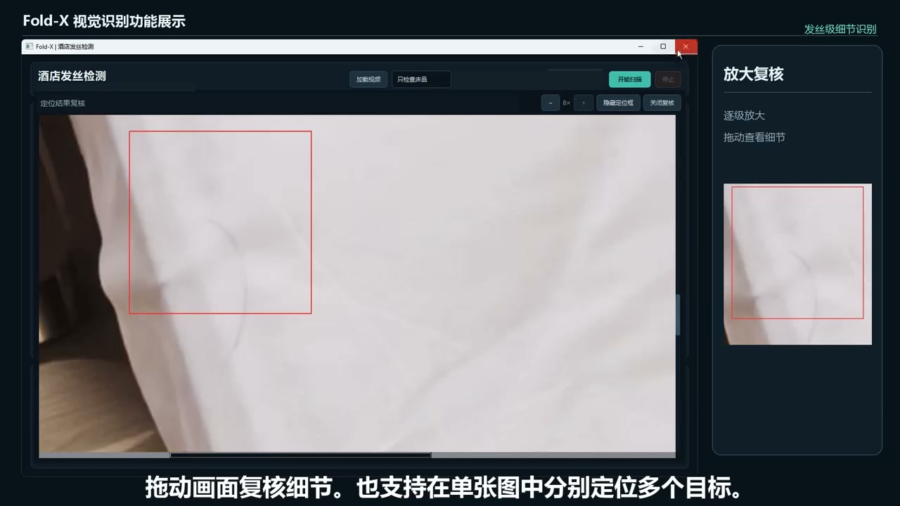

# Case 08 · Bedding quality inspection: hair detection

[中文版](../../cases/08-fine-detail.md)

**Fine-detail visual quality inspection**

The application supports bedding cleanliness checks by flagging fine, low-contrast hair candidates among fabric textures and folds, marking their locations, and opening enlarged views. The focus is visual quality inspection: spotting potential issues, locating the evidence, and supporting human review.

## The next step in the capability story

The progression moves from understanding a scene to checking its quality: use small foreign-material candidates to identify areas that need attention and provide visual evidence for review.

## Watch the demo

[Open player · approx. 46 seconds](https://skywalkerhm.github.io/Fold-X/en/cases/08-fine-detail.html)

## Where this can help

Turn details that require frame-by-frame searching into candidate locations for human review and records, with potential pilots in linen inspection and textile foreign-material screening.

- **Hospitality and linen checks**：Flag possible hair or foreign material on bedding for cleaning review.
- **Textile and surface inspection**：Explore fine-fiber, foreign-material, and small visual-anomaly screening, validated on samples from the intended materials and lighting.
- **Production footage review and traceability**：Route candidate frames and regions to human reviewers, with timestamps and supporting visual records.

## What the recording shows

- The demo first limits inspection to bedding, then scans the video and displays candidate results.
- The results list shows candidates at two timestamps. Red boxes mark locations, and opening a result enables progressively enlarged views.
- Candidate scores in the interface are not measured detection accuracy; this example does not establish reliable recognition of every small target.

This is a functional demo, without validated production-site miss rates, false-positive rates, or throughput. Display magnification does not increase the original image resolution.

**Timing scope**：The edited demo is approximately 46 seconds long and includes enlarged views. Its duration is not an end-to-end detection benchmark or evidence of millisecond latency.

## Key frames

### Limit inspection to bedding

### Candidate timestamps and marked locations

### Enlarge low-contrast details for review

[All capabilities](https://skywalkerhm.github.io/Fold-X/en/#cases)
