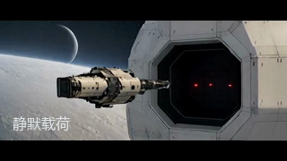
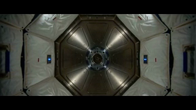
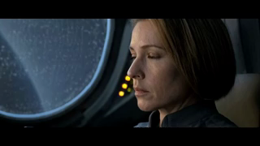
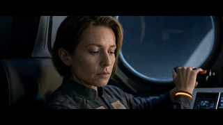

# One-click video generation · Silent Payload

**Video generation & cross-shot consistency**

A 50-second science-fiction sample illustrates an exploration of one-click video generation, with attention to character appearance, settings, lighting and color across shots.

The user reports one-click generation from long prompts and improvements in facial stability, scene continuity and color consistency.

[Watch / 观看样片](https://skywalkerhm.github.io/Fold-X/en/cases/09-video-generation.html)

Potential applications include concept films, storyboard previews and creative prototyping. This extends the showcase from understanding visual content to generating a sequence of scenes.

This is an output sample, not a recording of the generation process. Original prompts, generation logs and multi-sample quality evaluations were not supplied; prompt limits, generation time and artifact rates remain unverified. The 50-second duration is playback time, not generation time.

